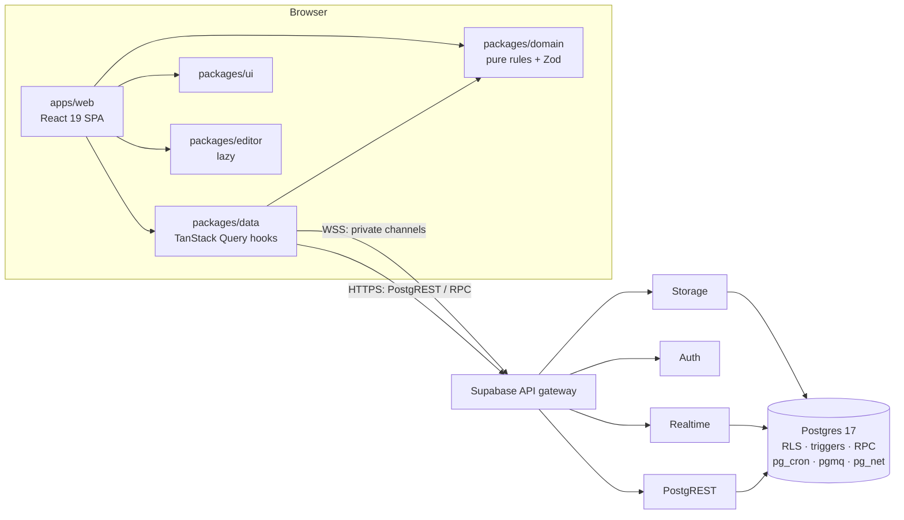

# Daiq Architecture

A one-page map. Decisions and their alternatives are in [docs/adr](docs/adr/README.md); the schema is in [docs/architecture/database-model.md](docs/architecture/database-model.md).

## System overview

- **Demo**: `apps/web` static build on GitHub Pages → hosted Supabase project.
- **Self-hosted**: `docker compose up -d` runs the Supabase services, a `migrate` job and an nginx `web` container serving the same build. See [ADR-0012](docs/adr/0012-deployment.md).

## Packages

| Path              | Responsibility                                                                                                                                                     | May import                   |
| ----------------- | ------------------------------------------------------------------------------------------------------------------------------------------------------------------ | ---------------------------- |
| `apps/web`        | Routes, screens, features (task list, board, palette…), app shell, shortcut registry                                                                               | all packages                 |
| `packages/domain` | Pure TypeScript: entity types, Zod schemas, view engine, ordering keys, identifiers, permission matrix, dates                                                      | `zod`, `fractional-indexing` |
| `packages/data`   | The only place that talks to Supabase: client factory, query keys, query/mutation hooks with optimistic cache patchers, realtime subscriptions, generated DB types | `domain`                     |
| `packages/ui`     | Design system: tokens, theme, Base UI components, command primitives, motion tokens                                                                                | —                            |
| `packages/editor` | Tiptap editor, shared schema, static renderer, Markdown/HTML conversion, sanitiser                                                                                 | `ui`                         |
| `supabase/`       | SQL migrations, seed, pgTAP tests, local config                                                                                                                    | —                            |
| `docker/`         | Self-host compose, web image, migrate job                                                                                                                          | —                            |

## Request lifecycle (edit a task's status)

1. User presses `S`, picks _In Progress_.
2. `useUpdateTask()` (packages/data) runs `onMutate`: cache patchers update every cached query containing the task; the row moves groups with a layout animation.
3. PostgREST `PATCH /tasks?id=eq.…` with only the changed column; RLS + column grants authorise it.
4. Triggers: `updated_at`, `started_at`/`completed_at`, `activity` row, notifications for subscribers, `realtime.send` to `team:<id>`.
5. Other clients receive `{entity:'task', id, op:'update'}`, refetch the row through PostgREST, patch caches.
6. On error the mutation rolls back and a toast explains why.

## Conventions

- Business rules never live in React components: components call hooks from `data` and pure functions from `domain`.
- Security never relies on the UI: every rule is enforced by RLS, constraints or RPC checks and tested in `supabase/tests`.
- Shared shapes are Zod schemas in `domain`; TypeScript types are inferred, not duplicated.
- Errors are typed (`DaiqError` with a `code`), logged with context, and surfaced to the user; nothing is swallowed.
- Every feature ships with the tests described in [docs/architecture/testing.md](docs/architecture/testing.md) and stays within [docs/architecture/performance.md](docs/architecture/performance.md).
