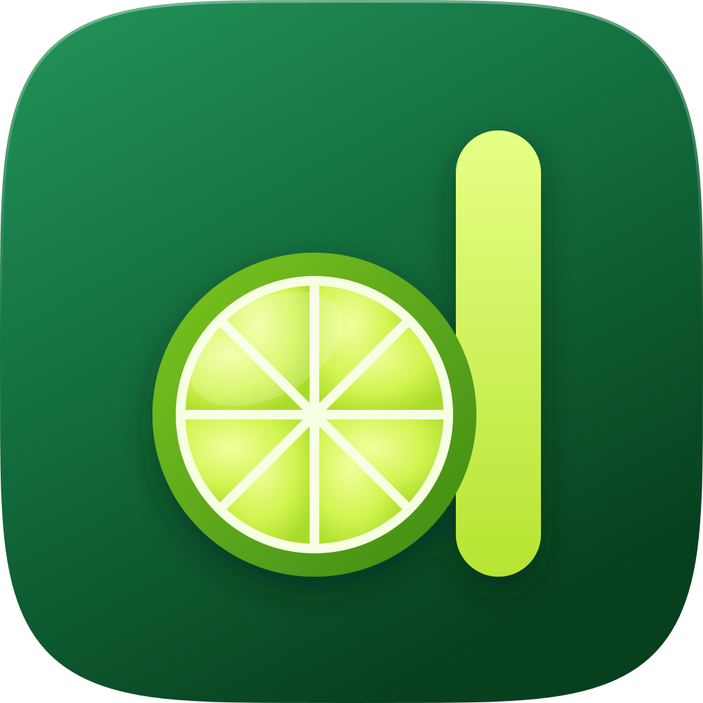
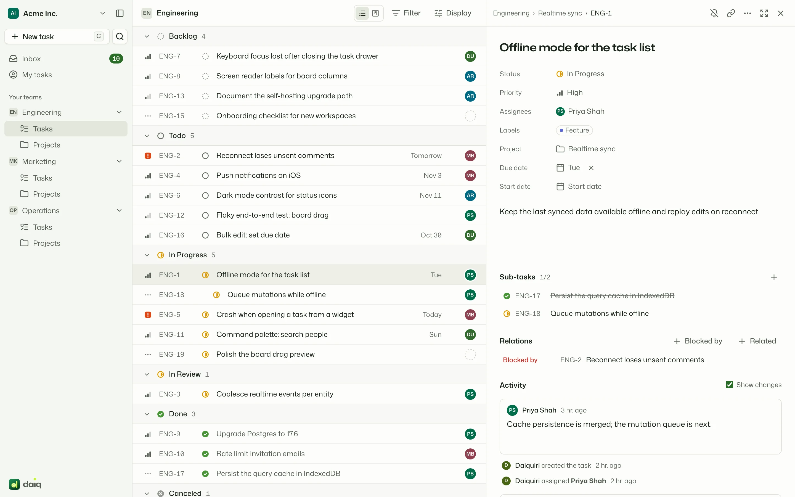
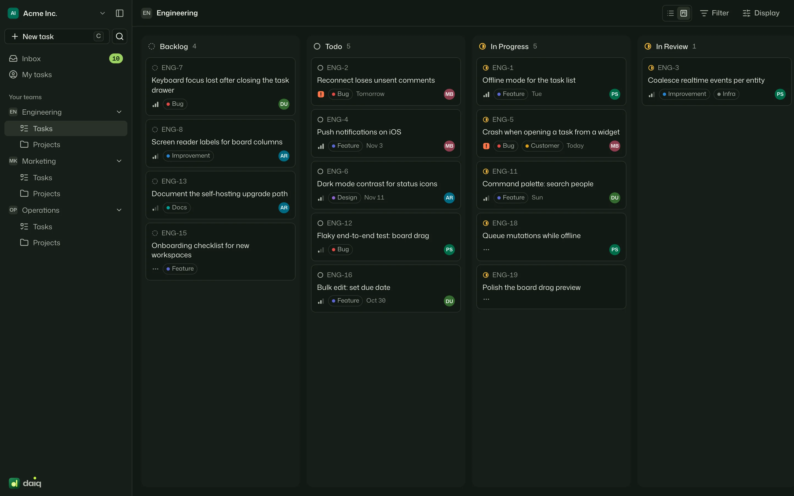
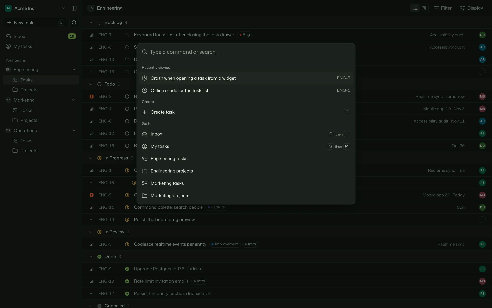
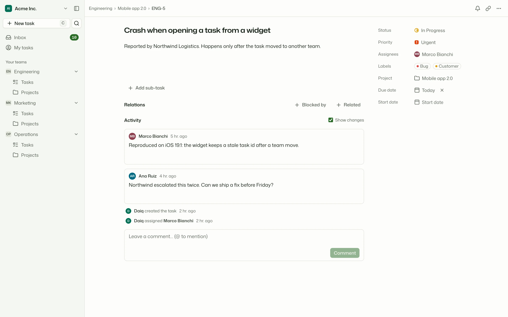
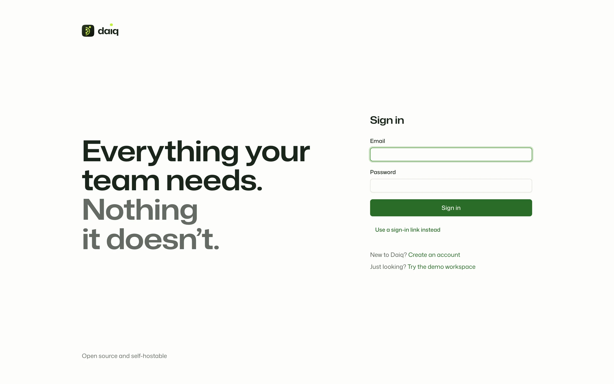

<div align="center">



# Daiquiri

**Everything your team needs. Nothing it doesn't.**

Open-source, keyboard-first work management for teams.<br>
Tasks, projects, boards and an inbox: fast, realtime and yours to host.

<a href="https://g1lg1l.github.io/daiquiri/"></a>

[](LICENSE)
[](https://react.dev)
[](https://www.typescriptlang.org)
[](https://supabase.com)
[](https://tailwindcss.com)
[](docker/README.md)

</div>

<br>

<picture>
  <source media="(prefers-color-scheme: dark)" srcset="docs/assets/screenshots/list-dark.webp">
  
</picture>

## Why Daiquiri

ClickUp, Asana and Linear each do a lot. Most teams use a small part of it, every day, and want that part to be instant. Daiquiri keeps that part and leaves out the configuration sprawl.

- **Instant.** Every change is optimistic, the cache survives reloads, teammates' edits arrive in realtime and long lists are virtualised.
- **Keyboard first.** `⌘K` reaches everything. `C` creates a task, `S` `P` `A` `L` `D` change the focused one, `G` then `I` opens the inbox. `?` lists every shortcut.
- **One clear model.** Workspace → Team → Project → Task. Every status belongs to one of five fixed categories, so views and reports always mean the same thing.
- **Secure in the database.** Tenant isolation is enforced by Postgres Row Level Security and checked by automated tests. The UI never relies on hiding buttons.
- **Yours to run.** One `docker compose up -d` on your own server, or a static build on GitHub Pages.

## A quick tour

<table>
  <tr>
    <td width="50%"></td>
    <td width="50%"></td>
  </tr>
  <tr>
    <td><b>Board.</b> Drag cards between statuses, or move them with the keyboard. List and board share filters, grouping and ordering, all kept in the URL.</td>
    <td><b>Command palette.</b> <code>⌘K</code> searches tasks, projects and people, and runs every command with its shortcut shown.</td>
  </tr>
  <tr>
    <td></td>
    <td></td>
  </tr>
  <tr>
    <td><b>Task page.</b> Rich-text description, sub-tasks, blocking relations, comments with @mentions and reactions, and a folded activity history.</td>
    <td><b>Start in seconds.</b> Sign up with a password or a magic link, or open a private demo sandbox with no account.</td>
  </tr>
</table>

## What you get

| Area          | Included today                                                                                                                                                                                                                                 |
| ------------- | ---------------------------------------------------------------------------------------------------------------------------------------------------------------------------------------------------------------------------------------------- |
| Work          | Teams with their own workflows, projects, tasks with identifiers (`ENG-42`), sub-tasks, relations, labels, priorities, due and start dates, custom fields, file attachments with image previews                                                |
| Planning      | Estimates in points or hours, cycles of one to four weeks that schedule themselves and roll unfinished work over, burn-up charts, project milestones and status updates with health, recurring tasks, task and project templates               |
| Views         | List, board, calendar, timeline (with dependency arrows) and insights, CSV/JSON export, filters (all or any), grouping with sub-groups and ordering in the URL, saved views and favorites, My tasks grouped by due date, undo for every change |
| Collaboration | Comments with @mentions and reactions, activity history, inbox notifications, subscriptions, realtime updates                                                                                                                                  |
| Workspace     | Invitations with roles (owner, admin, member, guest), private teams, team templates, labels, automations with a run log, notification levels per team, theme preferences                                                                       |
| Quality       | Light, dark and system themes, reduced motion, WCAG 2.2 AA contrast, screen-reader labels, full keyboard support                                                                                                                               |

## Tech stack

| Layer    | Choices                                                                                                                                                  |
| -------- | -------------------------------------------------------------------------------------------------------------------------------------------------------- |
| Frontend | React 19, Vite 8, TanStack Router and Query (persisted to IndexedDB), TanStack Virtual, Tailwind CSS 4, Base UI, cmdk, Tiptap 3, Pragmatic drag and drop |
| Backend  | Supabase: Postgres 17 with Row Level Security, PostgREST, GoTrue auth, Realtime broadcast from triggers, pg_cron                                         |
| Domain   | Pure TypeScript package with Zod 4 schemas: view engine, fractional ordering, identifiers, permissions                                                   |
| Quality  | TypeScript 7 strict, oxlint (type-aware), Prettier, Vitest, pgTAP for every RLS policy, Playwright with axe                                              |
| Delivery | pnpm 12 workspaces and Turborepo, GitHub Actions, GitHub Pages demo, Docker Compose with an unprivileged nginx image                                     |

Every choice is recorded with its alternatives in the [architecture decision records](docs/adr/README.md).

## Quick start

You need Node 24, pnpm 12 and Docker (for the local Supabase stack).

```bash
pnpm install
pnpm db:start   # local Supabase with migrations and demo data
pnpm dev        # http://localhost:5173
```

Sign in as `dev@daiq.local` with password `daiq-dev-password`, create your own account, or choose **Try the demo workspace**.

## Self-hosting

```bash
cp docker/.env.example docker/.env   # fill in secrets, see docker/README.md
pnpm docker:up                       # Daiquiri on http://localhost:3000
```

The stack runs Postgres, Auth, PostgREST, Realtime and Storage from pinned Supabase images, applies migrations with a one-shot job and serves the app from nginx on the same origin. Backups, upgrades and health checks are covered in [docker/README.md](docker/README.md).

<details>
<summary><b>All commands</b></summary>

| Command                               | What it does                                                     |
| ------------------------------------- | ---------------------------------------------------------------- |
| `pnpm dev`                            | Run the web app against the local Supabase stack                 |
| `pnpm build`                          | Production build                                                 |
| `pnpm lint`                           | Type-aware lint (oxlint)                                         |
| `pnpm format` / `pnpm format:check`   | Prettier                                                         |
| `pnpm typecheck`                      | TypeScript 7 across the monorepo                                 |
| `pnpm test`                           | Unit and component tests (Vitest)                                |
| `pnpm test:e2e`                       | End-to-end tests (Playwright, needs `pnpm db:start`)             |
| `pnpm db:start` / `pnpm db:stop`      | Start or stop the local Supabase stack                           |
| `pnpm db:migrate`                     | Apply new migrations to the local database                       |
| `pnpm db:seed`                        | Reset the local database, then re-apply migrations and seed data |
| `pnpm db:test`                        | Database tests for RLS, triggers and RPCs (pgTAP)                |
| `pnpm db:types`                       | Regenerate `packages/data/src/database.types.ts`                 |
| `pnpm docker:up` / `pnpm docker:down` | Start or stop the self-hosted stack                              |

</details>

<details>
<summary><b>Repository layout</b></summary>

```
apps/web            React SPA: routes, features, app shell
packages/domain     Pure domain rules and Zod schemas (no I/O)
packages/data       The only package that talks to Supabase: typed hooks, optimistic cache, realtime
packages/ui         Design system: tokens, theme, Base UI components
packages/editor     Tiptap editor, sanitiser, Markdown and HTML conversion
supabase/           SQL migrations, seed data, pgTAP tests
docker/             Self-hosting: compose stack, web and migrate images
docs/               Research, product spec, architecture, ADRs
```

Start with [ARCHITECTURE.md](ARCHITECTURE.md), then [docs/plan.md](docs/plan.md).

</details>

## Roadmap

- [x] Foundation: auth, workspaces, invitations and roles, RLS with tests, app shell, palette, themes
- [x] Core: teams and workflows, projects, tasks, list, board, calendar and timeline, task page, comments, inbox, search, realtime
- [x] Delivery: Docker self-hosting, CI, GitHub Pages demo build, end-to-end tests
- [x] Saved views (personal or shared) and favorites in the sidebar
- [x] Estimates and cycles with burn-up
- [x] Project milestones and status updates
- [x] Custom fields per team (text, number, date, select, person, checkbox, link), with grouping and filters
- [ ] Time tracking
- [x] File attachments on private storage
- [x] Recurring tasks, on a schedule or after completion
- [x] Task templates (with sub-tasks) and project templates (with milestones and tasks)
- [x] Automations: when a task changes, if it matches, then up to three actions, with a run log
- [x] Insights on every view (throughput, burn-up, cycle and lead time, time in status) and CSV/JSON export
- [x] Notification levels per team, any-filter matching, list sub-groups
- [ ] Intake forms that create tasks in triage
- [ ] Weekly reminders to post a project update
- [ ] Integrations: webhooks, API tokens, Slack, importers from Linear, Asana and ClickUp

The full order and rationale are in [implementation priorities](docs/product/implementation-priorities.md).

## Documentation

- **Product:** [principles](docs/product/product-principles.md), [feature spec](docs/product/daiq-feature-spec.md), [information architecture](docs/product/information-architecture.md), [keyboard](docs/product/keyboard-navigation.md)
- **Research:** [ClickUp](docs/research/clickup-analysis.md), [Asana](docs/research/asana-analysis.md), [Linear](docs/research/linear-analysis.md), [feature matrix](docs/research/competitor-feature-matrix.md), [tech stack](docs/research/tech-stack-research.md)
- **Architecture:** [database model](docs/architecture/database-model.md), [threat model](docs/architecture/threat-model.md), [performance](docs/architecture/performance.md), [testing](docs/architecture/testing.md), [ADRs](docs/adr/README.md)

## Contributing and security

Contributions are welcome: [CONTRIBUTING.md](CONTRIBUTING.md) explains the setup and what a change needs before it is merged. Please report vulnerabilities privately as described in [SECURITY.md](SECURITY.md).

## License

Daiquiri is free software under the [GNU Affero General Public License v3.0](LICENSE) (`AGPL-3.0-only`).

You can use, self-host, modify and redistribute it. If you run a modified version for other people over a network, the AGPL requires you to offer them the source code of your version.
