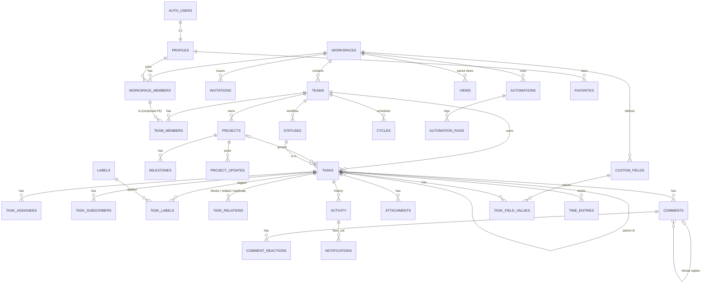

# Daiq — Database Model

Postgres (via Supabase) is the system of record. This document is the reference for the schema in `supabase/migrations/`; when they disagree, the migrations win and this file must be fixed.

## 1. Principles

1. **Every tenant row carries `workspace_id`.** It is the RLS anchor and the leading column of most indexes.
2. **Invariants live in the database.** Cross-row rules ("the status belongs to the task's team", "the assignee is a member of the workspace") are *composite foreign keys*, not application checks. A buggy client cannot create a cross-tenant reference.
3. **RLS on every table in `public`.** No table is reachable through PostgREST without a policy. `anon` gets nothing except what the demo flow explicitly needs.
4. **Writes that touch several rows go through RPC functions** (one transaction, one permission check). Single-row edits use PostgREST directly, restricted by column-level `GRANT`s and RLS.
5. **Side effects are triggers.** Activity events, notifications, sequence numbers, timestamps and realtime broadcasts are produced by triggers, so *every* write path — app, SQL console, migration, future API — produces them (lesson from Linear's Jan 2024 incident, see [linear-analysis.md §6.2](../research/linear-analysis.md)).
6. **UUID v4 primary keys** (`gen_random_uuid()`), but clients may supply their own UUID on insert. That makes optimistic creation trivial: the client knows the final id before the server answers. Human identifiers (`ENG-142`) are a per-team sequence.
7. **Manual ordering uses fractional index keys** (`text collate "C"`), so moving one item writes one row.
8. **Timestamps are `timestamptz`; calendar dates (due/start) are `date`.** A due date is a day, not an instant.

## 2. Schemas

| Schema | Contents | Exposed via PostgREST |
|---|---|---|
| `public` | Tenant tables, views and RPC functions the client may call | Yes |
| `app` | Private helpers: permission functions, trigger functions, internal tables | No |
| `auth`, `storage`, `realtime` | Supabase-managed | Through Supabase APIs only |

## 3. Entity relationship diagram



## 4. Tables

Priority tags match [implementation-priorities.md](../product/implementation-priorities.md). P0/P1 tables are created in the first migrations; P2+ tables are added by the slice that needs them.

### 4.1 Identity and tenancy (P0)

**`profiles`** — public profile for each `auth.users` row (created by trigger on sign-up).
- `id uuid pk → auth.users(id) on delete cascade`, `display_name text not null`, `avatar_url text`, `created_at`.
- RLS: a user sees their own profile and profiles of people who share a workspace with them; updates only their own.

**`workspaces`** — tenant.
- `id uuid pk`, `slug text unique` (`^[a-z0-9](-?[a-z0-9])*$`, 2–40 chars), `name text` (1–80), `created_by uuid`, `is_demo boolean default false`, `created_at`.
- Created only through `create_workspace(name, slug)` (inserts workspace + owner membership + default team + default workflow atomically).

**`workspace_members`** — `pk (workspace_id, user_id)`.
- `role app.workspace_role` ∈ `owner | admin | member | guest`, `created_at`.
- Constraint trigger: a workspace always keeps ≥ 1 owner.

**`invitations`**
- `id`, `workspace_id`, `email citext`, `role` (not `owner`), `token_hash bytea unique` (SHA-256 of a random token; the raw token exists only in the invite link), `invited_by`, `expires_at` (default now + 7 days), `accepted_at`, `revoked_at`.
- Partial unique index on `(workspace_id, email) where accepted_at is null and revoked_at is null`.
- Accepted only via `accept_invitation(token)` (security definer; checks expiry, revocation and that the caller's verified email matches).

**`teams`**
- `id`, `workspace_id`, `key text` (`^[A-Z][A-Z0-9]{1,5}$`, unique per workspace), `name`, `description`, `is_private boolean`, `task_seq integer default 0`, `cycles_enabled`, `estimates_enabled`, `triage_enabled`, `created_at`.
- `unique (workspace_id, id)` exists to be the target of composite foreign keys.

**`team_members`** — `pk (team_id, user_id)`, `workspace_id`.
- `foreign key (workspace_id, team_id) → teams(workspace_id, id)` and `foreign key (workspace_id, user_id) → workspace_members(workspace_id, user_id) on delete cascade`. Removing someone from the workspace removes them from every team.

### 4.2 Work (P1)

**`statuses`**
- `id`, `workspace_id`, `team_id`, `name` (unique per team, case-insensitive), `category app.status_category` ∈ `triage | backlog | unstarted | started | completed | canceled`, `position integer`, `created_at`.
- `unique (team_id, id)` for composite FKs.
- Deleting a status requires moving its tasks (RPC `delete_status(id, replacement_id)`); every non-triage category keeps ≥ 1 status (constraint trigger).

**`projects`**
- `id`, `workspace_id`, `team_id`, `name`, `description jsonb` (editor document), `status app.project_status` ∈ `planned | active | paused | completed | canceled`, `lead_id`, `start_date date`, `target_date date` (`check target_date >= start_date`), `sort_key`, `archived_at`, `created_by`, `created_at`, `updated_at`.
- `foreign key (workspace_id, lead_id) → workspace_members`.
- `unique (team_id, id)`.

**`tasks`**

| Column | Type | Notes |
|---|---|---|
| `id` | `uuid pk` | client-suppliable |
| `workspace_id` | `uuid` | |
| `team_id` | `uuid` | `fk (workspace_id, team_id) → teams` |
| `number` | `integer` | assigned by trigger from `teams.task_seq`; `unique (team_id, number)` |
| `title` | `text` | 1–500 chars |
| `description` | `jsonb` | canonical editor document (see [ADR-0005](../adr/0005-editor.md)) |
| `description_text` | `text` | plain text derived on write, for search & previews |
| `status_id` | `uuid` | `fk (team_id, status_id) → statuses(team_id, id)` — status must belong to the same team |
| `priority` | `smallint` | 0 none, 1 urgent, 2 high, 3 medium, 4 low (`check between 0 and 4`) |
| `project_id` | `uuid null` | `fk (team_id, project_id) → projects(team_id, id)` |
| `parent_id` | `uuid null` | `fk (team_id, parent_id) → tasks(team_id, id)`; depth ≤ 3 and no cycles (trigger) |
| `creator_id` | `uuid` | |
| `start_date`, `due_date` | `date null` | `check (due_date >= start_date)` |
| `estimate` | `smallint null` | only meaningful if the team enables estimates |
| `sort_key` | `text collate "C"` | fractional index for manual order |
| `completed_at`, `canceled_at` | `timestamptz` | maintained by trigger from the status category |
| `deleted_at` | `timestamptz` | trash; purged after 30 days |
| `created_at`, `updated_at` | `timestamptz` | |
| `search` | `tsvector` | generated from title (weight A) + description_text (weight B) |

**Many-to-many and relations**
- `task_assignees (task_id, user_id, workspace_id)` — pk `(task_id, user_id)`; `fk (workspace_id, user_id) → workspace_members`.
- `task_subscribers (task_id, user_id, workspace_id)` — same shape. Auto-filled by triggers on create, assign, comment, mention.
- `labels (id, workspace_id, name, color)` — `color` is a palette token (`check color in (...)`), unique name per workspace.
- `task_labels (task_id, label_id, workspace_id)` — both FKs composite with `workspace_id`.
- `task_relations (id, workspace_id, task_id, related_task_id, kind)` — `kind` ∈ `blocks | related | duplicate`; `check (task_id <> related_task_id)`; unique `(task_id, related_task_id, kind)`. "Blocked by" is the inverse read of `blocks`.

**`comments`**
- `id`, `workspace_id`, `task_id`, `parent_id null` (one level of threading: replies cannot have replies, enforced by trigger), `author_id`, `body jsonb`, `body_text`, `created_at`, `updated_at`, `edited_at`, `deleted_at`.
- Authors may edit/delete their own comments; admins may delete any.

**`comment_reactions (comment_id, user_id, emoji, workspace_id)`** — pk `(comment_id, user_id, emoji)`; `emoji` ≤ 32 chars.

### 4.3 History and notifications (P1)

**`activity`** — append-only history, written only by triggers.
- `id bigint generated always as identity`, `workspace_id`, `team_id`, `task_id null`, `project_id null`, `actor_id null` (null = system/automation), `kind text` (`task.created`, `task.status_changed`, `task.assignee_added`, `comment.created`, …), `data jsonb` (`{from, to}` snapshots), `created_at`.
- Edits by the creator within 3 minutes of creation are folded into `task.created` (noise reduction, as Linear does).
- No `UPDATE`/`DELETE` grants for any client role.

**`notifications`**
- `id`, `workspace_id`, `user_id` (recipient), `task_id`, `activity_id → activity`, `kind`, `actor_id`, `read_at`, `snoozed_until`, `archived_at`, `created_at`.
- Created by triggers from activity for subscribers, assignees and mentioned users — never for the actor themself.
- Clients may only update `read_at`, `snoozed_until`, `archived_at` on their own rows.

### 4.4 Personalisation (P1)

- `views (id, workspace_id, team_id null, owner_id, name, is_shared, config jsonb, created_at, updated_at)` — `config` validated by the shared Zod schema on the client and a `pg_jsonschema` check constraint on the server.
- `favorites (user_id, workspace_id, entity_kind, entity_id, sort_key)` — pk `(user_id, entity_kind, entity_id)`.

### 4.5 Advanced (P2+)

| Table | Purpose |
|---|---|
| `cycles (id, workspace_id, team_id, number, starts_on, ends_on)` + `tasks.cycle_id` | Optional per-team cadence with rollover |
| `milestones (id, workspace_id, project_id, name, target_date, sort_key)` + `tasks.milestone_id` | Project checkpoints |
| `project_updates (id, workspace_id, project_id, author_id, health, body, created_at)` | On track / at risk / off track posts |
| `custom_fields (id, workspace_id, name, kind, options jsonb, position)` + `team_custom_fields` | ≤ 8 kinds: text, number, date, select, multi_select, person, checkbox, url |
| `task_field_values (task_id, field_id, workspace_id, value jsonb)` | Typed value validated by trigger against `kind` |
| `attachments (id, workspace_id, task_id, comment_id, storage_path, file_name, mime_type, size_bytes, uploaded_by)` | Files in Supabase Storage bucket `attachments/{workspace_id}/…` |
| `time_entries (id, workspace_id, task_id, user_id, started_at, ended_at, duration_seconds, note)` | Time tracking |
| `templates (id, workspace_id, team_id, kind, name, payload jsonb)` | Task / project templates |
| `forms (id, workspace_id, team_id, slug, config jsonb, is_public)` | Intake forms → triage |
| `automations (id, workspace_id, team_id, name, trigger jsonb, conditions jsonb, actions jsonb, enabled)` + `automation_runs` | Rule engine ([ADR-0009](../adr/0009-automations-and-jobs.md)) |
| `webhooks (id, workspace_id, url, secret_hash, events text[], enabled)` + `webhook_deliveries` | Outbound webhooks via `pg_net` |
| `recurrences (task_id, rule jsonb, next_run_at)` | Recurring tasks via `pg_cron` |

## 5. Tenant boundaries and RLS strategy

### Roles

| Role | Can |
|---|---|
| `owner` | Everything, including deleting the workspace and managing owners |
| `admin` | Manage members, teams, labels, fields, automations; see all non-private teams |
| `member` | Work in every public team and private teams they belong to; create teams and projects |
| `guest` | Only teams they are explicitly a member of; cannot see the member directory beyond those teams; cannot create teams |

### Helper functions (`app` schema, `security definer`, `stable`, `set search_path = ''`)

- `app.workspace_role(ws uuid) → app.workspace_role` — the caller's role or null.
- `app.is_workspace_member(ws uuid) → boolean`.
- `app.accessible_team_ids() → setof uuid` — every team the caller can read: non-private teams of workspaces where they are a non-guest member, plus teams they belong to.
- `app.can_admin_workspace(ws uuid) → boolean`.

Policies use the **set-returning** form so Postgres evaluates the helper once per statement (an InitPlan) instead of once per row:

```sql
create policy tasks_select on public.tasks for select to authenticated
  using (deleted_at is null and team_id in (select app.accessible_team_ids()));
```

Every helper reads `auth.uid()` through `(select auth.uid())` for the same reason.

### Fail-closed rules

- No policy grants access based on a column the client can write without a matching `WITH CHECK`.
- `workspace_id` / `team_id` / `number` / `creator_id` are excluded from `UPDATE` column grants on `tasks`; moving a task between teams is an RPC.
- RLS is enabled *and forced* on every table; a CI check (`supabase/tests/000_rls_enabled.test.sql`) fails if any `public` table lacks RLS or policies.
- Realtime private channels authorise topics through RLS on `realtime.messages` using the same helpers ([ADR-0007](../adr/0007-realtime.md)).

## 6. Indexes (by access pattern)

| Query | Index |
|---|---|
| Team task list (most frequent) | `tasks (team_id, sort_key) where deleted_at is null` |
| Board / grouping by status | `tasks (team_id, status_id) where deleted_at is null` |
| Project task list | `tasks (project_id, sort_key) where deleted_at is null and project_id is not null` |
| Sub-tasks of a task | `tasks (parent_id) where parent_id is not null` |
| Open by identifier (`ENG-142`) | `unique (team_id, number)` + `teams (workspace_id, key)` |
| My tasks | `task_assignees (user_id, task_id)` |
| Due-date buckets / calendar | `tasks (workspace_id, due_date) where due_date is not null and deleted_at is null` |
| Full-text search | `gin (search)` on tasks; `gin (title gin_trgm_ops)` for fuzzy title matches |
| Task comments | `comments (task_id, created_at)` |
| Task activity | `activity (task_id, id desc)` |
| Inbox | `notifications (user_id, created_at desc) where archived_at is null` |
| Reverse relation lookups | `task_relations (related_task_id)` |
| RLS helpers | `workspace_members (user_id)`, `team_members (user_id)` |

Composite primary keys already index their leading columns; foreign-key columns not covered by a leading index get their own index (checked by `supabase db lint`).

## 7. Deletion strategy

| Entity | Strategy |
|---|---|
| Workspace | Hard delete by owner via RPC → cascades to everything |
| Team | Hard delete by admin via RPC, only when it has no tasks (otherwise archive by moving tasks) |
| Project | `archived_at` (hidden from sidebar and pickers); hard delete moves tasks to the team backlog |
| Task | Soft delete (`deleted_at`) via `delete_tasks(ids)` RPC, undo via `restore_tasks(ids)`, `pg_cron` purges after 30 days |
| Comment | Soft delete (`deleted_at`; body cleared, row kept so threads stay intact) |
| Membership | Hard delete; authored content keeps `author_id`/`creator_id` (profiles are not deleted with memberships) |
| User account | Supabase Auth deletion → profile cascades; authored rows keep a dangling reference rendered as "Deleted user" (FKs to `profiles` use `on delete set null` where nullable) |

## 8. Audit strategy

- `activity` is the user-facing audit trail for tasks and projects (who changed what, from → to).
- Membership, role, invitation and permission changes write `activity` rows with `task_id = null` (`member.role_changed`, `invitation.created`, …) so admins can review them in *Settings → Audit log* (P3 UI; data captured from P0).
- Activity rows are immutable for every client role; only the 30-day trash purge and workspace deletion remove them.

## 9. Migrations

- Plain SQL files in `supabase/migrations/`, timestamped, applied in order by the Supabase CLI (`supabase db push` / `supabase migration up`) or by the self-hosted `migrate` container.
- Migrations are forward-only and deterministic: no `now()`-dependent data, no environment branching.
- `supabase/seed.sql` contains realistic demo data and is only applied in local development and the demo project.
- Generated TypeScript types (`supabase gen types typescript --local`) are committed to `packages/data/src/database.types.ts` and checked in CI for drift.
