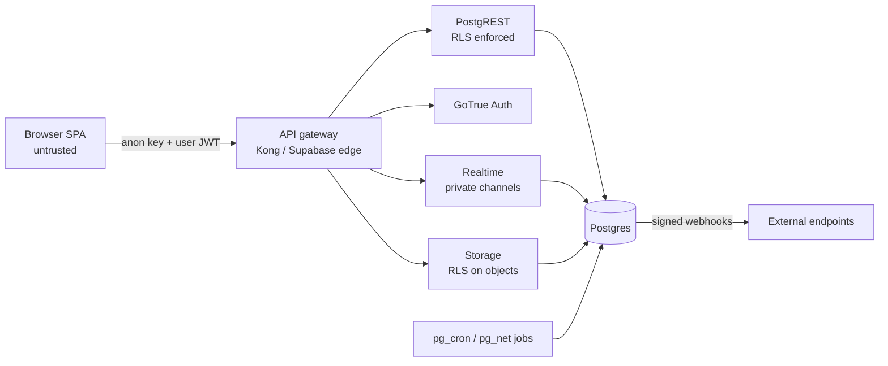

# Daiq — Threat Model

Daiq is treated as a multi-tenant SaaS even when self-hosted: one installation may host many unrelated workspaces, and the public demo is reachable by anyone.

## Assets

1. Workspace content (tasks, comments, attachments, project data).
2. Membership and role data (who can see what).
3. Authentication material (sessions, refresh tokens, invitation tokens).
4. Infrastructure secrets (service-role key, JWT secret, database password, webhook secrets).
5. Availability of the demo and self-hosted instances.

## Trust boundaries

Everything left of the gateway is attacker-controlled. The only credentials shipped to browsers are the **anon (publishable) key** and the user's own JWT. The service-role key never leaves server-side containers and is not referenced by any package that the web app imports (enforced by a CI grep).

## Threats and mitigations

| #   | Threat                                                                              | Mitigation                                                                                                                                                                                                                                                                                                                                                         | Verified by                                                          |
| --- | ----------------------------------------------------------------------------------- | ------------------------------------------------------------------------------------------------------------------------------------------------------------------------------------------------------------------------------------------------------------------------------------------------------------------------------------------------------------------ | -------------------------------------------------------------------- |
| T1  | **Broken tenant isolation** — reading or writing another workspace's rows           | RLS forced on every `public` table; policies use `app.accessible_team_ids()` / `app.is_workspace_member()`; composite FKs `(workspace_id, …)` make cross-tenant references impossible                                                                                                                                                                              | pgTAP RLS suite (`supabase/tests`), `000_rls_enabled` meta-test      |
| T2  | **IDOR** via guessed UUIDs or identifiers                                           | Same RLS as T1 — knowing an id grants nothing; identifiers resolve through RLS-filtered queries; 404 (not 403) for inaccessible resources                                                                                                                                                                                                                          | RLS tests per table                                                  |
| T3  | **Privilege escalation** (member → admin, guest → member, self-invite as owner)     | Role changes only via RPCs that check `app.can_admin_workspace`; `owner` cannot be granted by invitation; last-owner constraint; column-level grants prevent writing `role`, `workspace_id`, `team_id`, `creator_id` directly                                                                                                                                      | RLS + RPC tests                                                      |
| T4  | **Private-team leakage** through joins, search, realtime, notifications or activity | Every table that references a team filters by `accessible_team_ids()`; search RPC is `security invoker`; realtime topics authorise via `realtime.messages` RLS; notifications are only created for users with access at creation time and re-checked on read                                                                                                       | Dedicated "private team" test file covering every surface            |
| T5  | **Fail-open permission bugs** (Linear Mar 2026 incident)                            | Helpers return empty sets on missing context (`auth.uid()` null ⇒ nothing); no `security definer` function returns rows without an explicit access predicate; tests for the unauthenticated path of every RPC                                                                                                                                                      | pgTAP tests run as `anon`, `authenticated` (non-member) and member   |
| T6  | **XSS** through rich text, titles, names, labels, URLs                              | Rich text stored as structured JSON, rendered by the editor schema (no raw HTML nodes); HTML export runs through DOMPurify with an allow-list; React escapes all other strings; link `href`s restricted to `http(s):`/`mailto:`; strict CSP on Pages and nginx                                                                                                     | Sanitizer tests with an XSS payload corpus; CSP header test in E2E   |
| T7  | **Malicious uploads**                                                               | Private bucket; storage policies tie every object to a task the caller can see (`{workspace}/{task}/{attachment}/{name}`); 25 MB limit in Storage and a DB check; only signed URLs; downloads use `Content-Disposition: attachment`; the app previews raster images only (never SVG/HTML); self-hosted nginx serves `/storage/` with `nosniff` and a `sandbox` CSP | `supabase/tests/100_attachments.test.sql`, `e2e/attachments.spec.ts` |
| T8  | **CSRF**                                                                            | Auth uses bearer JWTs in the `Authorization` header (not cookies), so cross-site requests carry no credentials; OAuth/magic-link use PKCE                                                                                                                                                                                                                          | Architecture (no cookie auth)                                        |
| T9  | **Rate abuse / spam** (sign-ups, demo sandboxes, forms, invitations)                | Supabase Auth rate limits + optional CAPTCHA; demo sandbox creation limited per anonymous user and globally per hour; invitations limited per workspace per day; public forms rate-limited per IP and size-capped                                                                                                                                                  | RPC tests for limits                                                 |
| T10 | **Invitation abuse** (token theft, replay, enumeration)                             | 256-bit random token, only its SHA-256 stored; single use; 7-day expiry; must match the signed-in user's verified email; revocable; constant response for unknown tokens                                                                                                                                                                                           | RPC tests                                                            |
| T11 | **Webhook abuse** (SSRF to internal network, secret leakage)                        | Destination URL must be `https` and resolve to a public address (blocked: private, loopback, link-local, metadata ranges) — checked at save time _and_ at send time; HMAC-SHA256 signature; secrets stored hashed / in Vault; per-workspace delivery rate limit                                                                                                    | Unit tests for URL validation (P3)                                   |
| T12 | **Open redirects** after login / magic link                                         | `redirectTo` restricted to same-origin relative paths; Supabase Auth redirect allow-list configured per environment                                                                                                                                                                                                                                                | Unit test for redirect sanitiser                                     |
| T13 | **Secrets leakage**                                                                 | No secrets in the repo or images; `.env.example` contains placeholders only; Docker images read config at runtime; GitHub Actions use environment secrets; gitleaks in CI                                                                                                                                                                                          | CI secret scan                                                       |
| T14 | **SQL injection**                                                                   | No dynamic SQL built from user input; PostgREST parameterises; RPCs use typed parameters; `format()` with `%I/%L` where identifiers are dynamic                                                                                                                                                                                                                    | Code review rule + lint                                              |
| T15 | **Denial of service via expensive queries**                                         | PostgREST `db-max-rows`, statement timeout for `authenticated`, pagination on every list, GIN indexes for search, limited filter depth                                                                                                                                                                                                                             | Query plan tests for hot paths                                       |
| T16 | **Demo data abuse** (illegal content hosted on the public demo)                     | Sandboxes are private to the anonymous session and deleted after 24 h; anonymous sessions cannot upload files (storage and table policies)                                                                                                                                                                                                                         | `100_attachments.test.sql`                                           |

| T17 | **Automation abuse**: rules that act across tenants, loop, or act with more rights than their author | Automations run as a system actor but only on their own team's tasks; `app.validate_automation()` rejects statuses, projects, labels, templates and people from another team or workspace when a rule is saved, and every action re-checks them when it runs; only admins and the team's members manage rules; chains stop at depth 3 and never repeat a rule; each run is a subtransaction with a logged outcome; automations notify nobody unless the action is _notify_; the _call webhook_ action is not built until outbound requests get SSRF protection (T11) | `150_automations.test.sql` (cross-workspace label rejected, guests denied, loop stops, failure rolls back, outsiders see no runs) |
| T18 | **CSV injection** in exports opened in a spreadsheet | Cells starting with `=`, `+`, `-`, `@`, tab or carriage return get a leading apostrophe; RFC 4180 quoting | `insights.test.ts`, `insights.spec.ts` |
| T19 | **Template payloads** replayed with stale or foreign references | Templates are saved and applied by `security invoker` functions, so RLS decides what can be read and created; people who left, deleted labels and fields the team no longer uses are dropped, and values that no longer fit their field are skipped | `140_templates.test.sql` |
| T20 | **Notification preferences** read or written for someone else | Rows are keyed by `auth.uid()` and policies only match the caller's own rows; the level is enforced by a trigger on `notifications`, so every path that creates one respects it | `160_notification_settings.test.sql` |

## Security checklist for every new table

1. `workspace_id` column + composite FK to its parent.
2. `alter table … enable row level security; alter table … force row level security;`
3. Select/insert/update/delete policies (or explicit absence, documented).
4. Column-level `grant update (…)` limited to user-editable columns.
5. pgTAP tests: non-member cannot read; member can read; guest outside team cannot read; cannot insert into another workspace.
6. Realtime topic authorisation if broadcast.
