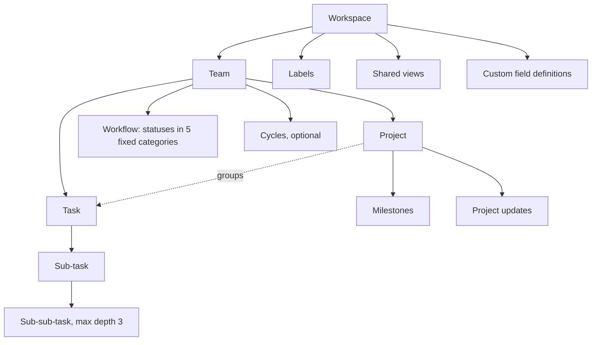

# Daiq — Information Architecture

Research basis: [clickup-analysis.md §2, §7](../research/clickup-analysis.md), [linear-analysis.md §2](../research/linear-analysis.md), [asana-analysis.md §2](../research/asana-analysis.md), [competitor-feature-matrix.md](../research/competitor-feature-matrix.md).

## 1. Hierarchy



| Level | What it is | Why it exists | What it replaces |
|---|---|---|---|
| **Workspace** | Tenant boundary: one company or community. Members, billing-free settings, labels, custom field definitions. | Isolation and identity. | ClickUp Workspace, Asana Organization, Linear Workspace |
| **Team** | A group of people who share a workflow. Owns statuses, task identifiers (`ENG-142`), privacy, optional modules (cycles, estimates). | The only configuration scope below the workspace. | ClickUp Space/Folder/List configuration, Asana Team, Linear Team |
| **Project** | A time-bound outcome inside a team: lead, status, target date, milestones, updates. Optional — tasks can live in the team backlog. | Planning and progress reporting. | ClickUp Folder/List, Asana Project, Linear Project |
| **Task** | The unit of work. Exactly one team, at most one project. | Everything else is a lens over tasks. | ClickUp Task, Asana Task, Linear Issue |
| **Sub-task** | A task with a parent. Same team; inherits project. Max depth 3, UI optimised for one level. | Breaking work down without checklists-vs-subtasks ambiguity. | ClickUp subtasks + checklists, Asana subtasks, Linear sub-issues |

Rules that keep the model simple:

1. **A task has one home.** No multi-homing (ClickUp "Tasks in Multiple Lists", Asana multi-homing). Cross-cutting needs are served by labels, saved views and relations.
2. **Configuration lives in exactly three scopes**: workspace, team, personal. No folder/list/view-level overrides.
3. **Statuses are named per team but always belong to one of five fixed categories** — Backlog, Unstarted, Started, Completed, Canceled (+ optional Triage). Reports, automations, progress and "overdue" use categories, never names. Moving a task between teams maps status by category automatically.
4. **Projects belong to one team.** Cross-team programmes are a deferred "Initiatives" layer, not a change to this rule.
5. **Lightweight checklists are task-list items inside the description** (`[ ]` in the editor). Real work is a sub-task. One primitive per job.

## 2. Navigation

```
┌──────────────────────┬──────────────────────────────────────────┬────────────────┐
│ ▾ Acme          ⌘K   │  ENG · Tasks       List  Board   Display │  ENG-142       │
│  ⊕ New task      C   │  ─────────────────────────────────────── │  side peek     │
│  ⌕ Search        /   │  ▾ In progress  3                        │                │
│                      │    ENG-142  Fix login redirect   ◔  ●    │                │
│  Inbox          4    │    ENG-139  Board drag latency   ◔  ●    │                │
│  My tasks            │  ▾ Todo  12                              │                │
│                      │    …                                     │                │
│  FAVORITES           │                                          │                │
│  ★ Launch v2         │                                          │                │
│                      │                                          │                │
│  TEAMS               │                                          │                │
│  ▾ Engineering       │                                          │                │
│     Tasks            │                                          │                │
│     Projects         │                                          │                │
│     Cycles           │                                          │                │
│  ▸ Marketing         │                                          │                │
│                      │                                          │                │
│  Views               │                                          │                │
│  ⚙ Settings          │                                          │                │
└──────────────────────┴──────────────────────────────────────────┴────────────────┘
```

### Sidebar (top to bottom)

1. **Workspace switcher** (name + avatar; menu: switch, settings, invite, theme, sign out).
2. **New task** (`C`) and **Search** (`/`).
3. **Inbox** (unread count) and **My tasks**.
4. **Favorites** — projects, views, tasks the user starred. Hidden when empty.
5. **Teams** — only teams the user belongs to. Each expands to *Tasks*, *Projects*, and *Cycles* when the team enables cycles.
6. **Views** (workspace-shared and personal saved views), **Settings**.

Nothing appears in the sidebar that the user did not join, star or need daily.

### Main view header

`Breadcrumb · View tabs (List | Board | Calendar | Timeline) · Filter chips (only when active) · Display ⌥`

### Detail

Opening a task shows a **side peek** (wide screens) or a full page (narrow screens or `Mod Enter`). The URL always reflects the open task so links are shareable.

## 3. URL design

Every screen has a stable, human-readable URL; view state lives in search params so links reproduce exactly what the sender saw.

| Route | Screen |
|---|---|
| `/` | Redirect to last workspace, or onboarding |
| `/login`, `/signup`, `/invite/:token` | Auth |
| `/:ws/inbox` | Inbox |
| `/:ws/my-tasks` | My tasks (tabs: assigned, created, subscribed) |
| `/:ws/team/:teamKey/tasks` | Team tasks (`?layout=board&group=status&priority=1,2`) |
| `/:ws/team/:teamKey/projects` | Team projects |
| `/:ws/team/:teamKey/cycles` | Team cycles |
| `/:ws/project/:projectId` | Project overview, with tabs for tasks, updates |
| `/:ws/task/:identifier` | Task page (`ENG-142`); old identifiers redirect after a team move |
| `/:ws/views/:viewId` | Saved view |
| `/:ws/settings/*` | Workspace, members, teams, labels, fields, profile, preferences |

On GitHub Pages the app is served under a base path (`/daiquiri/`); the router's `basepath` is derived from `import.meta.env.BASE_URL`, never hard-coded.

## 4. Personal surfaces

- **Inbox** — notifications about things the user participates in: assigned, mentioned, commented thread, explicitly subscribed. Tabs: *Inbox*, *Snoozed*, *Archived*.
- **My tasks** — tasks assigned to me, grouped by due bucket (Overdue, Today, This week, Later, No date). Tabs: *Assigned*, *Created*, *Subscribed*.
- **Recently viewed** — surfaced in the command palette (empty query), not as a sidebar section.

## 5. Settings map

| Scope | Sections |
|---|---|
| Personal | Profile, Preferences (theme, density, keyboard), Notifications |
| Workspace | General, Members & invitations, Teams, Labels, Custom fields, Templates, Automations, Webhooks & API, Import/Export |
| Team | General (name, key, privacy), Members, Workflow (statuses), Modules (cycles, estimates, triage), Templates |

Settings pages double as onboarding: every page explains in one sentence what the setting changes and shows the default.
