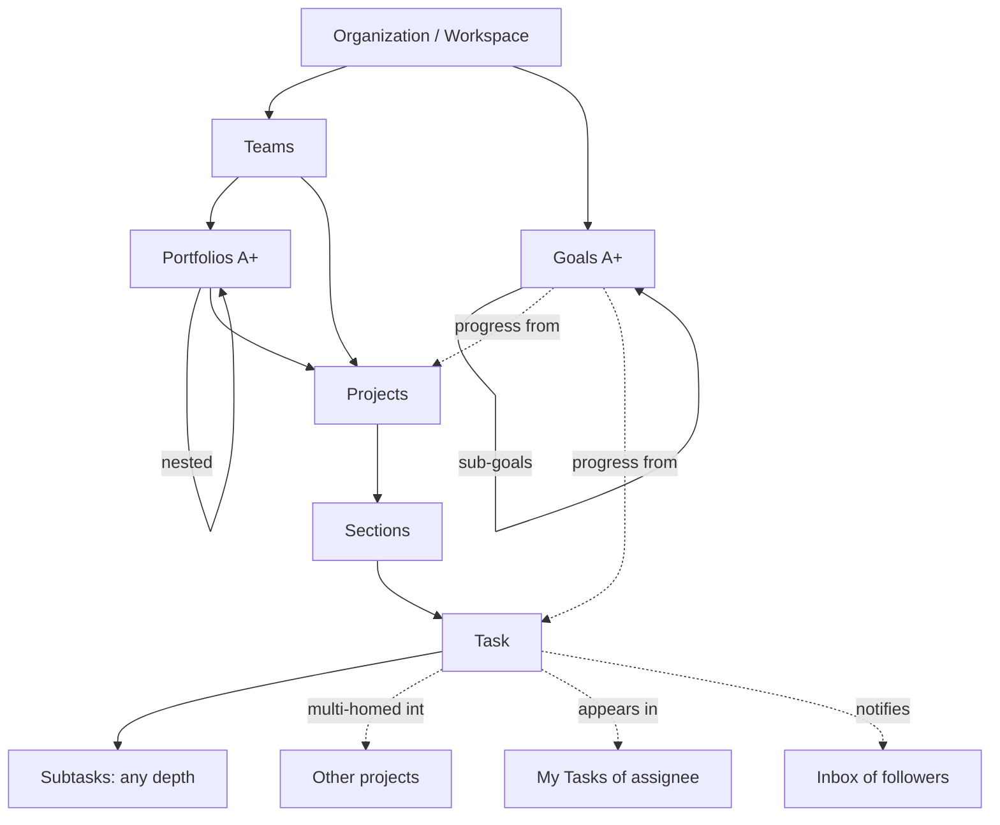

# Asana — Product Analysis for Daiq

> Research date: **2026-10-22**. Scope: Asana work management (web), Personal → Enterprise+ tiers, as documented on 2026-10-22.
> Purpose: work out which parts of Asana's power Daiq should **reproduce**, **simplify** or **avoid**, in line with
> [`product-principles.md`](../product/product-principles.md) and [`ux-principles.md`](../product/ux-principles.md).

## TL;DR

- Asana's core is excellent and small: **one task object** (single assignee, dates, fields, subtasks, dependencies)
  that can live in **several projects at once** (multi-homing), plus **My Tasks** (what I must do) kept apart from
  **Inbox** (what I should know).
- Everything around that core has grown into a large surface: goals, nested portfolios, custom task types, bundles,
  a canvas-style automation builder, universal reporting, capacity plans, timesheets, Pages, Meetings, AI Teammates,
  plus four sibling products. In 2026 the sidebar was split into five "modes" to hold it all [S5].
- Most friction comes from **gating by plan** (approvals, time tracking, formulas, portfolios and goals need Advanced;
  capacity planning needs Enterprise; several things are paid add-ons). Close behind are **notification noise**,
  **side effects of multi-homing** (fields from every project pile up on one task), **subtask behaviour that changes
  with depth**, and **reporting that needs setup**.
- For Daiq: copy the task model, the My Tasks/Inbox split, dependencies and the keyboard flows. Shrink portfolios,
  goals, rules and reporting to zero-setup versions. Do not copy tier gating, product sprawl, credit-metered AI or
  per-project field build-up.

---

## 1. Method & sources

**Method.** Asana's own documentation was read on 2026-10-22:

- Help Center articles. The site renders client-side, so the pages were opened in a headless browser and their text extracted.
- Developer docs, fetched as Markdown through `developers.asana.com/llms.txt`.
- The pricing comparison table, fetched as Markdown from `asana.com/pricing.md`.
- Monthly release notes from Sep 2025 to Sep 2026, and the Q3 2026 "What's new" page.

User sentiment comes from the Asana Community Forum (user-written, hosted by Asana) and from review aggregators.
Capterra returned HTTP 403 to direct fetches, so its figures come from search-engine snippets. Many forum performance
threads date from 2019–2023 and are marked as such. Proprietary text is summarised, not copied.

| ID | Source | URL | Accessed |
|---|---|---|---|
| S1 | Asana pricing & full feature comparison | https://asana.com/pricing (also `/pricing.md`) | 2026-10-22 |
| S2 | What's new — Q3 2026 release | https://asana.com/whats-new | 2026-10-22 |
| S3 | Release notes (Sep 2025 – Sep 2026) | https://help.asana.com/s/article/release-notes | 2026-10-22 |
| S4 | How Asana works (object & people model) | https://help.asana.com/s/article/how-asana-works | 2026-10-22 |
| S5 | New navigation (modes) | https://help.asana.com/s/article/new-navigation-in-asana | 2026-10-22 |
| S6 | Workspaces & organizations FAQ | https://help.asana.com/s/article/workspaces-and-organizations-faq | 2026-10-22 |
| S7 | Multi-homing tasks | https://help.asana.com/s/article/how-to-multi-home-tasks | 2026-10-22 |
| S8 | Rules / automations | https://help.asana.com/s/article/rules | 2026-10-22 |
| S9 | Conditions & branching in rules | https://help.asana.com/s/article/conditions-and-branching-in-rules | 2026-10-22 |
| S10 | Task dependencies | https://help.asana.com/s/article/task-dependencies | 2026-10-22 |
| S11 | Approvals | https://help.asana.com/s/article/approvals | 2026-10-22 |
| S12 | Custom task types & statuses | https://help.asana.com/s/article/custom-task-types | 2026-10-22 |
| S13 | Custom fields | https://help.asana.com/s/article/custom-fields | 2026-10-22 |
| S14 | Portfolios overview | https://help.asana.com/s/article/portfolios-overview | 2026-10-22 |
| S15 | Goals: set & track | https://help.asana.com/s/article/setting-and-tracking-progress-towards-goals | 2026-10-22 |
| S16 | Universal reporting | https://help.asana.com/s/article/universal-reporting | 2026-10-22 |
| S17 | Resource planning (portfolio workload, capacity plans) | https://help.asana.com/s/article/resource-planning | 2026-10-22 |
| S18 | Inbox | https://help.asana.com/s/article/stay-informed-with-your-asana-inbox | 2026-10-22 |
| S19 | Notification settings | https://help.asana.com/s/article/notification-settings | 2026-10-22 |
| S20 | Keyboard shortcuts | https://help.asana.com/s/article/keyboard-shortcuts | 2026-10-22 |
| S21 | Feature pages: My Tasks, Workload, Forms, Time tracking, Rules | https://asana.com/features (`/features/project-management/my-tasks`, `/features/resource-management/workload`, `/features/workflow-automation/forms`, `/features/resource-management/time-tracking`) | 2026-10-22 |
| S22 | Asana AI / Agentic Work Management | https://asana.com/product/ai | 2026-10-22 |
| S23 | "Inside the Build": rule duplication (May 2026) | https://asana.com/resources/how-asana-makes-complex-rules-work-everywhere | 2026-10-22 |
| S24 | API: Tasks schema | https://developers.asana.com/reference/tasks | 2026-10-22 |
| S25 | API: Custom fields guide | https://developers.asana.com/docs/custom-fields-guide | 2026-10-22 |
| S26 | API: Status updates | https://developers.asana.com/reference/status-updates | 2026-10-22 |
| S27 | API: Rate limits | https://developers.asana.com/docs/rate-limits | 2026-10-22 |
| S28 | API: Webhooks guide | https://developers.asana.com/docs/webhooks-guide | 2026-10-22 |
| S29 | API: Search tasks in a workspace | https://developers.asana.com/reference/searchtasksforworkspace | 2026-10-22 |
| S30 | API index (resources incl. MCP, allocations, budgets, custom types) | https://developers.asana.com/llms.txt | 2026-10-22 |
| S31 | Command by Asana announcement | https://asana.com/inside-asana/command-by-asana | 2026-10-22 |
| S32 | Project privacy & roles (admin/editor/commenter/viewer) | https://help.asana.com/s/article/how-to-manage-project-privacy | 2026-10-22 |

| ID | Evidence (community / third party) | URL | Accessed |
|---|---|---|---|
| E1 | Forum: "Assign multiple assignees on one task" (long-running, 30+ pages) | https://forum.asana.com/t/assign-multiple-assignees-on-one-task/1176 | 2026-10-22 |
| E2 | Forum: Notification overload — best practices | https://forum.asana.com/t/notification-overload-best-practices-to-decrease-notifications/854073 | 2026-10-22 |
| E3 | Forum: Turning off inbox notifications for applied rules | https://forum.asana.com/t/turning-off-inbox-notifications-for-applied-rules/64497 | 2026-10-22 |
| E4 | Forum: Unexpected notifications in inbox (rule-owner bug, Aug 2026) | https://forum.asana.com/t/unexpected-notifications-in-inbox/1153354 | 2026-10-22 |
| E5 | Forum: "Rules — Help!" (moderator: new editor confuses clients) | https://forum.asana.com/t/rules-help/918991 | 2026-10-22 |
| E6 | Forum: New rule builder exit-path bug (Sep 2026) | https://forum.asana.com/t/new-rule-builder-upon-exit-takes-you-back-to-customize-menu-instead-of-automations-list/1156032 | 2026-10-22 |
| E7 | Forum: Asana's new navigation experience (feedback thread) | https://forum.asana.com/t/asanas-new-navigation-experience/1104749 | 2026-10-22 |
| E8 | Forum: Hide custom fields from other projects on multi-homed tasks | https://forum.asana.com/t/the-ability-to-hide-custom-fields-applied-to-a-task-that-dont-belong-to-the-project-in-which-the-task-is-being-viewed/79740 | 2026-10-22 |
| E9 | Forum: Updated view of projects & custom fields in tasks (2026) | https://forum.asana.com/t/updated-view-of-projects-and-custom-fields-within-tasks-needs-improving/1117994 | 2026-10-22 |
| E10 | Forum: Subtasks hidden when list is sorted | https://forum.asana.com/t/display-subtasks-on-list-view-when-project-is-sorted/887655 | 2026-10-22 |
| E11 | Forum: 2000+ tasks breaks project list view; ~1000 tasks in collapsed sections (older) | https://forum.asana.com/t/2000-tasks-breaks-projects-list-view-unusable/142270 , https://forum.asana.com/t/asana-stops-working-properly-in-projects-with-more-than-1000-tasks-hidden-under-collapsed-sections/187950 | 2026-10-22 |
| E12 | Forum: Pages slow to load, high latency | https://forum.asana.com/t/pages-are-slow-to-load-high-latency/1102210 | 2026-10-22 |
| E13 | Forum: Seat-block pricing complaints | https://forum.asana.com/t/please-consider-selling-seat-blocks-in-smaller-increments/1144197 , https://forum.asana.com/t/asana-pricing-is-unfair-and-takes-advantage-of-its-customers/1058878 | 2026-10-22 |
| E14 | Capterra reviews (≈4.5/5, ≈13.6k reviews; via search snippets) | https://www.capterra.com/p/184581/Asana/reviews | 2026-10-22 |
| E15 | Software Finder reviews (UI praise / clutter) | https://softwarefinder.com/project-management-software/asana/reviews | 2026-10-22 |
| E16 | Asana blog: performance rewrite, "2x faster" (2017, historic) | https://asana.com/inside-asana/asana-speed-performance-updates-2017-beyond | 2026-10-22 |

Tier shorthand used below: **P** Personal (free, 2 users) · **S** Starter ($10.99/user/mo annual) ·
**A** Advanced ($24.99) · **E** Enterprise · **E+** Enterprise+ · **add-on** = paid extra [S1].
A trailing `+` means "this tier and above" (S+, A+). A bare **E** also includes E+.
Prices are per user per month, billed annually. Monthly billing is $13.49 (S) and $30.49 (A).

---

## 2. Product & information architecture

**People and tenancy** [S4][S6]
- **Organization**: tied to a company email domain. Anyone who signs up with that domain joins automatically.
  **Workspace**: a tenant without a domain that "acts like a single team". Neither can see the other.
- **Teams** sit inside an organization and map to departments. Privacy options: public, request-to-join (the default
  for new paid domains since Jun 2026 [S3]), private. In large organizations, **divisions** split billing and administration.
- **Members** have full access. **Guests** (anyone outside the domain; free and unlimited on S+) see only what is shared
  with them. **Limited-access members** see only the projects they were added to inside a team.
- Project roles: admin / editor / commenter / viewer [S32]. Portfolios: admin / editor / viewer.

**Work objects** [S4][S14][S15]
- **Goals** (A+): company, team or individual goals, nested as parent and sub-goals. Progress is entered by hand or
  rolls up from sub-goals, projects or tasks. Goals can be weighted (A+). Goal types and templates are E.
- **Portfolios** (A+): sets of projects and of other portfolios (nested). They carry custom fields, status updates,
  workload, dashboards and portfolio-level rules.
- **Projects** contain **sections**, then **tasks**, then **subtasks** to any depth. A project can be teamless.
  Projects also have Overview/brief, Messages, Files, Notes and Dashboard tabs, plus a "Customize" menu for configuration.
- **Multi-homing** (all tiers): one task can belong to several projects. It sits in its own section in each project,
  edits show everywhere, and there is never a copy [S7]. The task carries the custom fields of **every** project it
  belongs to, and its single task type and custom status travel with it [S12][E8].
- **My Tasks** is a per-user list with user-defined sections. **Inbox** is the per-user notification feed.

**2026 navigation "modes"** [S5][S2]: **Work** (Home, Inbox, My tasks, projects, portfolios) ·
**Agents** (AI Teammates, rules, forms, task types, custom fields, bundles, status-update templates) ·
**Strategy** (goals, workload, capacity plans, reporting) · **Knowledge** (Pages, Meetings) · **Company** (teams, people).
A "More" menu holds sibling products: Client Management, Service Management, **Command** (planning for developer teams,
the same market as Linear [S31]) and StackAI.

**Assessment.** There are three containers above a task (goal, portfolio, project), two of which nest. A task can also
belong to N projects, and subtasks can belong to projects of their own. That is powerful, but it leaves users asking
"where does this task live?" and "why does it have 40 fields?" [E8][E9]. Daiq's planned Workspace → Team → Project →
Task hierarchy is deliberately shallower.

---

## 3. Task model

**Core fields** (from the API `Task` schema [S24]):

| Group | Fields | Notes |
|---|---|---|
| Identity | `gid`, `name`, `permalink_url`, `resource_subtype` | Subtypes are `default_task`, `milestone`, `approval`, plus `custom_type` (Starter+) |
| Ownership | `assignee` (**single**), `assigned_by`, `followers` (collaborators), `created_by` | Multiple assignees are refused as a matter of product philosophy [E1] |
| Dates | `due_on` / `due_at`, `start_on` / `start_at` | Start dates and times are S+ [S1]. Milestones cannot have a start date [S24] |
| Completion | `completed`, `completed_at`, `completed_by` | **Completion is a boolean.** Richer status comes from sections, custom fields or custom task types |
| Approval | `approval_status`: pending / approved / changes_requested / rejected | Kept in sync with `completed`. Approvals need A+ [S11] |
| Custom type | `custom_type`, `custom_type_status_option` | Custom statuses, each mapped to complete or incomplete (S+) [S12] |
| Body | `notes`, `html_notes` | Rich text. Collaborative editing (Jun 2026), threaded comments (Sep 2026), markdown paste [S3] |
| Placement | `memberships[] {project, section}`, `projects[]`, `parent`, `assignee_section` | Multi-homing lives here. `assignee_section` is the task's section in the assignee's My Tasks |
| Relations | dependencies / dependents, subtasks (`num_subtasks`), tags | Dependencies are S+ [S1] |
| Data | `custom_fields[]`, `actual_time_minutes` | Time tracking is A+ |
| Social | likes / hearts, stories (comments + activity), attachments | — |
| Derived | `has_subtasks_date_mismatch`, `is_rendered_as_separator` | Subtask date roll-up check. Separators are subtasks that act like sections |

**Task types.** There are four: task, milestone, approval, and custom type (since 2025/26). Each task has exactly one
type. A task template can set the type, and a project can choose its default type, so "+ Add task" becomes, for
example, "+ Add Marketing request" [S12].

**Relations.**
- **Subtasks**:
  - Nest to any depth, but many features stop at the first level. Rules don't run on sub-subtasks [S8], only
    first-level subtasks inherit the parent's custom fields [S13], and some project views hide deeper levels [E10].
  - Subtasks are **not** in the parent's project unless multi-homed there.
- **Dependencies**:
  - Shown as split "Blocked by" and "Blocking" columns in list view. Can be drawn on the timeline, can cross
    projects, and can auto-shift dates.
  - The dependent task's assignee is notified when the blocking task is completed or its due date changes. When there
    are several blockers, a single notification arrives once all are done [S10].
- **Reference custom fields** link a task to tasks, projects, portfolios, goals or teams (S+/A+) [S25][S3].

**Custom fields** [S13][S25][S3]
- **Types**: text (rich text since Aug 2026); number (number, currency, percent, custom label); single-select;
  multi-select; date; people; reference; formula (A+, two layers deep); ID (prefix up to 20 characters, for task keys
  like `ENG-123`); time tracking (estimated and actual); timer.
- **Scope**: *local* fields belong to one project or portfolio. *Global* fields live in the organization's **field
  library**. Fields can also be attached to users, goals and portfolios.
- **Limits**: 150 fields per project (raised from 100 in early 2026), 500 options per select field (fields near the
  limit can be migrated to reference fields), 1,024 characters for text through the API. Fields are attached only one
  level down (portfolio → project, not → task).
- **Governance**: field admin, editor and user roles; locking (S+); restricting who may edit values (E). Deleted
  fields can be recovered for 30 days.

---

## 4. Feature inventory by domain

**Projects & views**
- Views: List, Board, Calendar and Notes (P). Timeline and Gantt (S+). Workload (A+ per portfolio, E organization-wide).
  Dashboard and Overview are per-project tabs. Views can be saved as tabs [S1].
- Sections (rules can attach to a section, marked by a lightning-bolt icon), recurring tasks, bulk actions,
  CSV import, project and task templates (S+), and critical path (A+) [S1][S8].
- 2026 quality-of-life changes: one-click expand/collapse of all sections and subtasks, collapsible board columns,
  card sizes, subtasks created from views, and a centralised trash [S3].

**My Tasks** (P) [S21]
- Shows every task assigned to me. The user creates and orders the sections; a "Recently assigned" section collects
  incoming work.
- Rules can auto-sort tasks (for example, move to "Today" when the due date arrives). Views: list, board, calendar.
  My-Tasks-specific fields (S+).

**Inbox & notifications** [S18][S19][S3]
- The Inbox is kept apart from My Tasks: it is information, not to-dos. Tabs: Activity, Bookmarks, Archive.
  Sort by Newest or Relevance; filters (messages and status updates since May 2026).
- Channels: inbox, email (daily summary, activity updates, mentions only, weekly report), browser notifications
  (five categories), mobile push (synced with inbox archive), Slack (including per-project channel routing),
  Do-not-disturb schedules, and per-project notification defaults.
- Following: assigning, @mentioning or commenting adds you as a collaborator. Unfollowing stops updates, except
  @mentions.

**Rules / automations** (S+; portfolio rules A+) [S8][S9][S23][S3]
- Created from a gallery of presets or in the custom builder; AI Studio can draft a rule from instructions.
- Model: **When** (up to 20 triggers) → **Check if** (paths with AND conditions, multiple branches and an "else"
  branch) → **Do** (up to 20 actions).
- Limits: **50 rules per project** on every tier. Rules can chain into other rules (opt-in). Edits are not
  retroactive, but manual triggers can be run on existing tasks.
- 2026 additions: rule and branch duplication across projects, round-robin assignment, assigning from people fields,
  project roles as an action, text-field triggers, "Let AI decide" model choice, Script Actions (Node.js, E), and
  bundles (E) to share rules, fields and templates across projects.

**Forms** (S+; branching and customisation A+) [S1][S21]
- Each response creates a task in the linked project. Questions map to fields. Branching goes up to 5 levels on
  single- and multi-select questions. Forms take attachments, carry branding and can be embedded.
- The submitter is added as a collaborator. Access can be limited to the organization or open to anyone.

**Approvals & proofing** (A+) [S11]
- An approval is a task type with three outcomes: approve, request changes, reject.
- Anyone, not only the assignee, can complete one; a comment-only project stops that.
- Proofing anchors comments to points on PDFs and images and turns them into subtasks.
- On downgrade, approvals lose their meaning and show as ordinary completed tasks.
- Multiple approvers arrived in Sep 2026, but only behind an add-on ("TBAO") [S3].

**Portfolios** (A+) [S14]
- Nested portfolios, custom fields, status updates and progress, a grid view with bulk actions (2026), portfolio
  workload, dashboards, rules, project templates attached to a portfolio, archiving, and PDF or PowerPoint summaries (E).

**Goals** (A+) [S15][S1]
- Objectives and key results in a parent/sub-goal tree. Progress is manual or automatic (from sub-goals, projects or
  tasks). Goals have a time period, privacy setting and owner, can be weighted, and appear on a strategy map, in
  dashboard widgets and in goal custom fields. Goal templates and types are E.

**Status updates** (P) [S26][S3]
- Project and portfolio statuses: on track, at risk, off track, on hold, complete, dropped.
- Goal statuses: on track, at risk, off track, achieved, partial, missed, dropped.
- Updates are sent to all followers. Reusable status-update templates arrived in Jun 2026.

**Reporting** [S16]
- Universal reporting (S+): dashboards made of charts on tasks, projects, portfolios or goals; the last three need A+.
- Charts group by assignee, creator, *global* custom field, task type, completion, project or time period. Values:
  count, time, or the sum or average of a global number field.
- Benchmark lines (May 2026). "Time to complete" is E only. Dashboards are private by default and read-only when
  shared.
- Separate surfaces: project dashboards, portfolio dashboards, advanced-search reports, Tableau, Power BI and
  Salesforce connectors (A+).

**Workload & capacity** [S17][S21][S1]
- Portfolio workload (A+): effort counted by tasks, hours, points or a formula, with a weekly capacity limit per person.
  Tasks can be dragged to reassign or reschedule. Compare mode shows estimates against actuals.
- Universal workload and **capacity plans** with project allocations, placeholder profiles and CSV export (E).
  Out-of-office entries (2026).

**Time tracking & money** [S1][S21]
- Estimated and actual time fields with a timer and log (A+).
- **Timesheets & Budgets** is a paid add-on on every paid tier: timesheets, user rates, project budgets.

**Search** [S1][S3][S29]
- Quick search on every tier. **Advanced search** (S+) filters by fields (including date and reference fields) and can
  be saved as a report. Saved searches cover "deleted" items.
- The search API is premium only (HTTP 402 otherwise), limited to 60 requests per minute, eventually consistent and
  without stable pagination.

**Permissions & admin** [S1][S6][S3]
- Private teams and projects, comment-only projects, admin console, app management (S+).
- E: SAML, SCIM, service accounts, view-only licences, guest-invite controls.
- Permissions-management add-on / E+: custom roles (RBAC) and permission controls.
- Compliance add-on / E+: audit log, SIEM, DLP, IP allowlisting (including API traffic since Jul 2026),
  data residency, enterprise key management, sandboxes, data retention policies.

**AI (scope signal only)** [S22][S2][S1]
- **AI Teammates** (30+ prebuilt agents), **Asana Dash** (an "AI chief of staff"), **AI Studio** (AI steps inside rules),
  Smart chat, prompt-to-project, and MCP/AI connectors (ChatGPT, Claude, Gemini).
- Metering: 5 requests per user per month, capped at 50 or 250 per account; 50K–200K AI Studio credits per month;
  extra requests cost $0.50–$0.60 each. AI has become Asana's main marketing message ("Agentic Work Management").

**API & webhooks** [S27][S28][S30]
- REST API with opt-in fields (`opt_fields`), batch API, events stream with sync tokens, and webhooks with an
  `X-Hook-Secret` handshake and HMAC signatures.
- Webhook delivery is **at most once**: on average within 1 minute, mostly within 10, never replayed.
- Rate limits per token: 150 requests per minute (free) or 1,500 (paid); 50 concurrent reads and 15 concurrent
  writes; a cost-based limit for large graph traversals; 5 concurrent duplicate/export jobs per user.
- Also: SCIM, audit-log API, graph exports, app components (UI embedded in tasks), Script Actions, and an official MCP
  server (V2).

---

## 5. Interaction patterns & keyboard workflows

**Tab-chord shortcut system** [S20]. Asana prefixes most task actions with `Tab`:

| Action | Keys | | Action | Keys |
|---|---|---|---|---|
| New task below / above | `Enter` / `⇧Enter` | | Quick add (global) | `Tab Q` |
| Complete | `⌘Enter` | | Assign / assign to me | `Tab A` / `Tab M` |
| Due date | `Tab D` | | Add to project (multi-home) | `Tab P` |
| Subtasks | `Tab S` | | Collaborators | `Tab F` |
| Comment / post | `Tab C` / `Tab Enter` | | Full screen / focus | `Tab X` |
| New section | `Tab N` | | Follow-up task | `⇧Tab F` |
| Reorder task | `⌘↑/↓` | | Move to prev/next section | `⌘⇧↑/↓` |
| My Tasks / Inbox / Home | `Tab Z` / `Tab I` / `Tab H` | | Search | `Tab /` |
| Inbox up/down, archive | `K`/`J`, `E` or `I` | | Shortcut sheet | `⌘/` |

**Patterns worth noting**
- **The list behaves like a text editor.** `Enter` creates the next row, and pasting several lines creates one task
  per line. `→→` moves into field cells, so the list doubles as a spreadsheet.
- **Right-hand task pane** for detail, `Esc` to close, `Tab X` for full screen. Multi-select with `⇧`/`⌘`-click and
  edit in bulk.
- **One "Customize" menu per project** holds fields, rules, forms, templates, task types and bundles. That keeps
  configuration out of daily work, but it is a deep menu.
- Board keyboard navigation (move cards between columns, edit titles) arrived only in Jun 2026 [S3].
  Dependencies are drawn by dragging on the timeline.
- **There is no general command palette** in the shortcut list. `Tab /` search is the universal entry point.
  The help article itself warns that shortcuts may fail on non-English keyboard layouts.

**Assessment.** The editor-like list and the `Enter`/paste flows are excellent and worth copying. The `Tab` prefix
avoids clashing with typing, but it conflicts with standard focus traversal and is hard to discover. Daiq's
`⌘K` + single-key approach (`C`, `/`, `?`) is the better model.

---

## 6. What users love (evidence)

1. **A clean, approachable interface on day one.** Reviewers repeatedly praise a tidy, minimal UI that keeps attention
   on the work [E14][E15]. Capterra rates it about 4.5/5 from about 13.6k reviews, with ease of use 4.4 [E14].
2. **The list feels like a notepad.** Quick capture, `Enter`/paste to create tasks, and keyboard reordering [S20].
   This is the core of Asana's reputation as a task tool.
3. **My Tasks as a personal command centre.** Personal sections, "Recently assigned" triage and auto-sort rules
   [S21][E15].
4. **One accountable owner.** Asana defends the single assignee as a deliberate choice for clarity and
   accountability, and keeps it despite a vocal group that wants multiple assignees [E1].
5. **Multi-homing.** The same task is visible to marketing and to legal without duplicates: one thread, one source of
   truth [S7].
6. **Dashboards and visibility for managers.** Reviewers highlight dashboards for tracking workload and spotting
   bottlenecks [E14]. Portfolios answer "how are all my projects doing?" in one grid [S14].
7. **Intake → automation.** Forms create tasks, and rules assign and route them (round-robin since Sep 2026). This
   replaces email request queues [S21][S3].
8. **Timeline and dependencies.** Visual timelines and blockers that notify the next person when work is unblocked
   [S10][E14].
9. **Breadth of integrations.** 100+ free integrations (Slack, Microsoft 365, Google, Zoom) on every tier [S1].

---

## 7. Where Asana creates complexity or friction (evidence)

**7.1 Tier gating spreads core primitives across five plans and three add-ons** [S1]
- **Free (P) is 2 users** and has no custom fields, timeline/Gantt, dependencies, forms, rules, milestones, start dates
  or advanced search.
- **A+ only**: approvals, time tracking, formulas, portfolios, goals, form branching, critical path, portfolio
  workload, Jira two-way sync.
- **E only**: capacity planning, organization-wide workload, bundles, Script Actions, SAML/SCIM, project-admin
  controls.
- **Add-ons**: Timesheets & Budgets; Compliance management; Permissions management; AI credits.
- **Seats come in blocks**: increments of 5 up to 30 users, then 10, 25 and 50 [S1]. A long run of forum complaints
  describes paying for a full block of unused seats [E13].
- Downgrading **changes the meaning of data**: approvals become plain completed tasks [S11]. The search API returns 402
  to users on non-premium plans [S29].

**7.2 Object and surface sprawl**
- To do one thing, a user may need to understand goals, portfolios (nested), projects, sections, tasks, subtasks,
  milestones, approvals, custom task types, tags, local and global fields, task and project templates, bundles,
  status updates, messages, Pages, Meetings and AI Teammates.
- The 2026 navigation regroups all of this into five modes plus "More" products [S5]. The feedback thread is largely
  negative: users ask to hide or collapse the rail, and the rollout has no opt-out [E7].

**7.3 Portfolio and goal overhead**
- Progress comes either from manual status updates or from wiring each goal to sub-goals, projects or tasks [S15].
- Status updates are a recurring ritual, now with templates [S3]. Asana's own case studies advertise hours saved on
  portfolio reporting (e.g. REWE), which suggests the overhead is real [S22].
- Goals, weighting, strategy maps, goal types (E) and goal custom fields add administration before any value appears.

**7.4 Notification noise**
- Asana says inbox notifications are a **superset** of email, and many events go to both [S19].
- Users describe the inbox as unusable when flooded by "due today" items and rule-generated events. For years there
  was no setting to silence notifications from rules [E2][E3].
- An Aug 2026 bug added rule owners as collaborators on every task their rules touched [E4].
- Asana's own fixes (inbox filters, @mention highlighting, push synced with archive [S3]) show that the default volume
  is too high.

**7.5 The rules UI has grown into a programming environment**
- Rules allow 20 triggers × branches × 20 actions, AI steps and Script Actions, capped at 50 rules per project [S8][S9].
- Rules run only on first-level subtasks. Rules with external actions can be edited only by their creator, so rules go
  "orphaned" when people leave and someone must claim ownership [S8].
- A forum moderator conceded that the new editor confuses the clients they support [E5]. Asana itself calls the
  builder "already-dense" [S23]. A Sep 2026 bug report on the builder's exit path shows rough edges remain [E6].

**7.6 Reporting needs setup**
- Charts can group only by *global* custom fields, so teams must promote local fields to the library before they can
  report on them [S16].
- Project-metadata, portfolio and goal charts need A+. "Time to complete" needs E.
- There are four different reporting surfaces: project dashboards, universal dashboards, portfolio dashboards and
  search reports.

**7.7 Side effects of multi-homing**
- Every project's fields pile up on a multi-homed task. Users report long, unordered field lists, fields past roughly
  50–60 no longer visible, and fields that don't apply to the current project [E8].
- A 2026 redesign of the task pane drew complaints that fields are now harder to edit in place [E9].
- Asana's own mitigations in 2026 confirm the pain: searching for fields in the task pane, and expanding or collapsing
  all projects in the task pane [S3].

**7.8 Subtask semantics change with depth**
- Subtasks are not in the project, don't inherit fields beyond the first level, aren't automated beyond the first
  level, and are hidden from list view when it is sorted or filtered [S8][S13][E10].
- Users can't predict where a subtask will appear (project, My Tasks, search).

**7.9 Three competing ways to express status**
- Completion is a boolean. "Status" is therefore modelled as a section, a single-select field, or (since 2025/26) a
  custom task type with its own statuses [S12][S24].
- Teams mix all three, and rules and reports must handle each one.

**7.10 Performance reputation**
- Asana rebuilt its client for speed in the late 2010s and claimed common actions became 2x faster [E16].
- Older forum threads say very large projects (1,000–2,000+ tasks, especially under collapsed sections) become
  unusable because whole sections load at once, and staff advised splitting projects [E11].
- Recent threads still report slow page loads [E12]. Mobile lag comes up in reviews [E14].
- Current speed is not benchmarked here, but large projects are a known weak spot.

**7.11 AI as a metered upsell**
- AI is capped per user and per account, consumed as credits, and partly sold as add-ons (AI Teammates) [S1].
- The navigation renamed "Workflow" to "Agents" [S5][E7]. Core configuration (rules, fields) now lives under an
  AI-branded section.

---

## 8. Recommendations for Daiq

### Reproduce (keep the power)

1. **Single accountable assignee plus subscribers.** Split shared work into subtasks. Matches Linear and Asana's
   rationale [E1]. Revisit only if real usage shows the need.
2. **Separate My Tasks from Inbox.** My Tasks holds actions (smart groups: Recently assigned, Today, Upcoming, Later,
   plus manual order). Inbox holds information (`J`/`K`, `E` to archive, bookmark, unfollow).
3. **Rows behave like text.** `Enter` creates the next task, `⇧Enter` the one above. Pasting N lines creates N tasks.
   `⌘↑/↓` reorders and `⌘⇧↑/↓` moves to the adjacent group. A follow-up-task action. A focus or full-page mode.
4. **Dependencies** with "Blocked by" and "Blocking" as two visible properties. When the last blocker completes, notify
   the dependent task's assignee **once**. Draw dependencies on the timeline.
5. **Milestones as a flag on a task**, not a separate object. They show as diamonds on the timeline and calendar.
6. **Forms → tasks** in a project, with question-to-field mapping and the submitter added as a subscriber. A public
   or workspace-only link.
7. **Structured project status updates** with a fixed set: on track, at risk, off track, on hold, complete, dropped.
   Show the latest one in project lists.
8. **Task keys** (`DAQ-142`), as Asana does with ID fields, but built in and always on.
9. **Recoverable deletes**: trash with restore (Asana keeps 30 days) plus immediate undo, as `ux-principles.md` requires.
10. **API hygiene**: sparse fieldsets (`fields=`), cursor pagination, an events feed with sync tokens, webhooks with
    HMAC signing and a handshake, per-token rate limits with `Retry-After`, and a published MCP server.
11. **Show automations where they act**: a section, status column or board column shows an icon when an automation is
    attached.

### Simplify (same outcome, a fraction of the surface)

1. **No multi-homing in v1.** Each task has one home project. Cross-project needs are covered by labels and by saved
   views that filter across projects ("all tasks labelled *Legal* in Team X"). If multi-homing is added later, the task
   should show only the fields of the project it is viewed in.
2. **One status field** with Daiq's five categories (backlog, unstarted, started, done, canceled) and
   per-team names. This replaces the boolean plus sections plus select fields plus custom task types.
3. **Portfolios and goals become one lightweight object** (e.g. *Initiative*): a named set of projects with an owner,
   a target date, an auto-computed rollup (percentage of tasks done, latest project statuses) and an optional status
   update. No weighting, no strategy map, no goal types.
4. **Automations as one linear sentence**: *When* [one trigger] *if* [optional AND filters] *then* [1–3 actions].
   About 10 triggers and 10 actions, no branches or else-paths, no scripts.
   - Runs as a system actor, never as the creator's credentials, so rules never become orphaned.
   - Never generates inbox notifications on its own.
   - Applies the same way at every subtask depth.
5. **Zero-setup insights per project and team**: counts by status, assignee and label; overdue; created vs completed;
   cycle time. Every field can be grouped, with no global-field requirement. A saved filtered view is the "report".
   No chart builder in v1.
6. **Notifications**: per project choose All / Participating (default) / Mute, plus a subscribe toggle per task.
   Bursts of edits collapse into one item. Email is off except a mentions-and-assignments digest. Due-date reminders
   are opt-in.
7. **Workload**: a single per-team view of open tasks per person by week, by count or estimate. No capacity plans,
   allocations or placeholder people.
8. **Custom fields**: six types (text, number, select, multi-select, date, person) defined at team level and reusable
   across that team's projects. Empty fields stay hidden on the task. Formulas, references and per-field permissions
   are deferred.
9. **Templates**: project templates only, capturing sections, tasks, fields and automations. Asana's separate
   *bundles*, task templates and custom task types are folded into this one concept.
10. **Subtasks**: one level, always shown inline under the parent in every view (sorted or not), always in the
    parent's project, inheriting the project's fields and automations.
11. **Permissions**: workspace roles (admin, member, guest), team membership, and project visibility (team or
    private) with edit / comment / view. No custom roles or RBAC.
12. **Time**: an optional estimate field plus a simple time log on any task, available on every installation. No
    timesheets or budgets.
13. **Approvals**: if needed, a "Needs review" status category with approve and request-changes buttons, not a
    separate task type.

### Avoid (deliberately leave out)

1. **Gating core primitives** (fields, dependencies, timeline, forms, automations, approvals, time, search API) by
   tier. Self-hosted Daiq ships everything. Data never changes meaning on any plan change.
2. **Seat blocks and per-seat lock-in** in the self-hosted edition.
3. **Product and navigation sprawl**: no modes, no Pages, Meetings, chat or docs (already Daiq anti-goals), and no
   sibling products in the sidebar.
4. **Credit-metered AI and agent "teammates" in the core.** Provide good APIs, webhooks and MCP so that AI is
   pluggable and optional.
5. **Fields piling up per project on a task**, and task panes listing dozens of empty fields.
6. **Behaviour that varies with depth or context**: automations or inheritance that stop at level 1, or subtasks that
   disappear when a view is sorted.
7. **Automations tied to a person**: external actions editable only by the creator, "claim ownership" flows, rules
   that add their owner as a follower.
8. **A configuration-first experience**: reports that require global fields, dashboards that start empty, a
   "Customize" menu that must be visited before the project feels usable.
9. **Rendering every task up front**: large projects must stay fast through virtualization, pagination and
   incremental loading, measured against the budgets in `docs/architecture/performance.md`.
10. **Email as a superset of the inbox**, and daily "due today" notification floods.
11. **Tab-chord shortcuts.** Use `⌘K` plus single-key, context-aware shortcuts with on-screen hints.
12. **An eventually consistent search with unstable order in the API.** Provide stable sorting and cursors.
