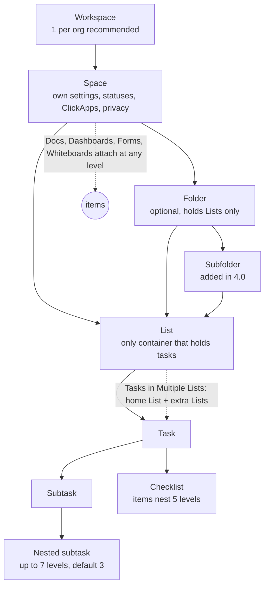
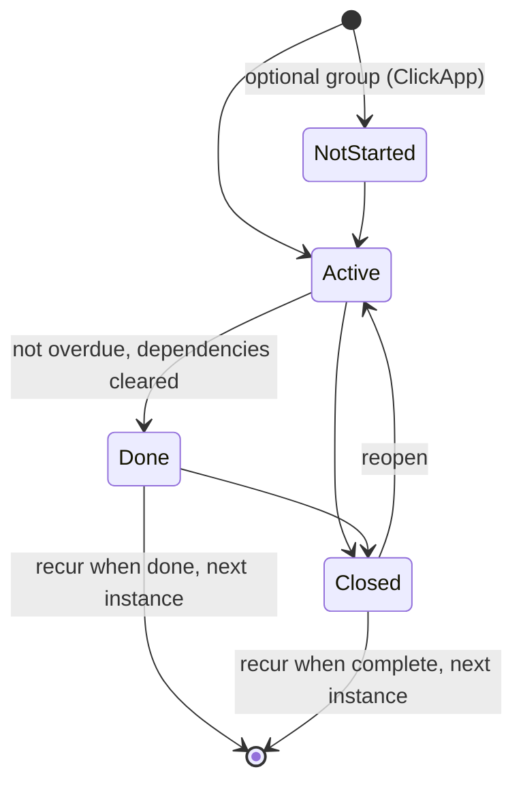

# ClickUp — Product Analysis for Daiq

> Research date: 2026-10-22 · Scope: externally observable behaviour, UX patterns, data model, state transitions.
> No proprietary code or assets were inspected. No workspace-specific content is recorded here.

**TL;DR for Daiq**
- ClickUp's core model is strong and worth copying: tasks with typed status *groups*, fixed priorities, multiple assignees, custom fields, dependencies, many views over one query, an inbox, and Cmd+K.
- Its complexity comes from three multipliers on top of that core: **container depth** (up to 5 container levels plus 7 levels of subtasks), **configuration at every level** (statuses, fields, automations, permissions and ClickApps each inherit and override separately), and **opt-in feature toggles** (38 ClickApps, many of them basic features).
- Users love the flexibility and the all-in-one promise. They complain about the learning curve, slowness, notification noise and navigation churn, and those complaints have stayed on the public feedback board for years.
- Daiq should keep the core primitives, cut the multipliers, and leave out Chat, Whiteboards, AI agents and metered "uses".

---

## 1. Method & sources

**Method**
- **REA status (verified 2026-10-22):** the `rea` CLI 6.4.0 (npm `rea-agents`) is installed and `rea mcp doctor` reports a healthy MCP server (170 tools), but it is **not registered as an MCP server in Claude Code**, so the REA MCP integration was unavailable to this research. To enable it later:
  ```bash
  rea mcp add          # registers REA as an MCP server (or: claude mcp add rea -- rea --mcp)
  rea doctor           # checks optional engines (Hopper is missing; not needed for web targets)
  ```
  Appropriate future use for Daiq is limited to *observing behaviour* of a ClickUp session the user is signed in to and authorised to use (e.g. `observe-web-session`, `capture-browser-scenario`, `capture-web-screenshot`) — never bundle decompilation/export (`analyze-web-bundle`, `export-web-scripts`), never bypassing authentication or bot protection. The fallback below covers the same questions from public sources.
- **Fallback 1, first-party sources:**
  - help.clickup.com: HTML pages returned 403 to automated fetches, so articles were read through the public Zendesk Help Center JSON API (`/api/v2/help_center/en-us/articles/{id}.json`). The "updated" dates below are the article dates.
  - developer.clickup.com, clickup.com/pricing, the official changelog (feedback.clickup.com/changelog), ClickUp Learn, and the ClickUp feedback board (user posts and staff replies).
- **ClickUp MCP connector (read-only introspection only):** only `clickup_get_schema` (entity-relationship model) and `clickup_get_operators` (bulk operator schemas) were called. Only generic model and shape facts were recorded. No task, list, people or workspace data was read or stored.
- **Fallback 2, third-party sources:** G2 and Capterra pages returned 403 or a Cloudflare challenge. Their evidence comes from search-engine summaries and snippets of those pages and is marked *(via search)*. The challenge was not bypassed. Reddit was not reachable, so ClickUp's public feedback board stands in for "Reddit-style" complaints.

**Sources** (all accessed 2026-10-22)

| # | Source | URL |
|---|---|---|
| S1 | Intro to the Hierarchy (upd. 2026-10-19) | https://help.clickup.com/hc/en-us/articles/13856392825367 |
| S2 | Intro to Spaces (limits) (upd. 2026-10-19) | https://help.clickup.com/hc/en-us/articles/6309466958103 |
| S3 | Manage task statuses (upd. 2026-10-14) | https://help.clickup.com/hc/en-us/articles/6309452618647 |
| S4 | Task statuses for Folders and Subfolders | https://help.clickup.com/hc/en-us/articles/6308803927831 |
| S5 | Intro to ClickApps (full ClickApp table) (upd. 2026-10-21) | https://help.clickup.com/hc/en-us/articles/6304327753111 |
| S6 | Custom Field types (upd. 2026-10-19) | https://help.clickup.com/hc/en-us/articles/6303499162647 |
| S7 | Custom task types; Intro to tasks | https://help.clickup.com/hc/en-us/articles/17564381376919 · …/10552031987735 |
| S8 | Create nested subtasks | https://help.clickup.com/hc/en-us/articles/6304431740055 |
| S9 | Tasks in Multiple Lists + FAQ | https://help.clickup.com/hc/en-us/articles/6309958824727 · …/7784081674263 |
| S10 | Tasks feature availability and limits | https://help.clickup.com/hc/en-us/articles/29664799512855 |
| S11 | Set task Priorities | https://help.clickup.com/hc/en-us/articles/6304483666199 |
| S12 | Multiple Assignees | https://help.clickup.com/hc/en-us/articles/6309029762583 |
| S13 | Add and remove task followers | https://help.clickup.com/hc/en-us/articles/6309004688663 |
| S14 | Use recurring tasks | https://help.clickup.com/hc/en-us/articles/6309885016471 |
| S15 | Use task checklists | https://help.clickup.com/hc/en-us/articles/6309942197783 |
| S16 | Intro to Dependency Relationships; Relationships on tasks | https://help.clickup.com/hc/en-us/articles/6309155073303 · …/29728065999383 |
| S17 | Intro to comments; Assign comments; Threaded Comments; Reactions | https://help.clickup.com/hc/en-us/articles/6309646134295 · …/6311126397591 · …/37683521255959 · …/6304535580695 |
| S18 | Add attachments to tasks | https://help.clickup.com/hc/en-us/articles/6309666546199 |
| S19 | Intro to Activity view | https://help.clickup.com/hc/en-us/articles/6310079875095 |
| S20 | Intro to time tracking; Intro to Time Estimates | https://help.clickup.com/hc/en-us/articles/6304291811479 · …/6304177391767 |
| S21 | Intro to Sprints; Use Sprint Points | https://help.clickup.com/hc/en-us/articles/6303974210071 · …/6303883602327 |
| S22 | Intro to Automations; Automations limits; Triggers; Actions | https://help.clickup.com/hc/en-us/articles/6312102752791 · …/23477062949911 · …/6312128853015 · …/6312097314199 |
| S23 | What is the Inbox?; Notification settings | https://help.clickup.com/hc/en-us/articles/33947959867543 · …/6325918957335 |
| S24 | Intro to views; Views Bar; views control bar; Views limits | https://help.clickup.com/hc/en-us/articles/6329880717719 · …/19063083658135 · …/35368731425175 · …/32274881672599 |
| S25 | Saving view filters; Me Mode | https://help.clickup.com/hc/en-us/articles/6311659064983 · …/6308948062871 |
| S26 | Intro to Dashboards; Intro to Overviews | https://help.clickup.com/hc/en-us/articles/6312197753239 · …/15115821058071 |
| S27 | Use keyboard shortcuts; Use /Slash Commands; AI Command Bar | https://help.clickup.com/hc/en-us/articles/6309030550167 · …/6308960837911 · …/6533695640343 |
| S28 | Intro to templates; Intro to Forms | https://help.clickup.com/hc/en-us/articles/6326144923159 · …/6310233090711 |
| S29 | User roles; Intro to permissions; Permissions in detail; Guest roles | https://help.clickup.com/hc/en-us/articles/6310033667223 · …/6309225399703 · …/6309221065495 · …/6310022323991 |
| S30 | Set up your team's Workspace; ClickUp Assist; Customizable features | https://help.clickup.com/hc/en-us/articles/9563779819031 · …/21867311353879 · …/9559764679831 |
| S31 | Brain AI; Super Agents; Chat; Tags limits | https://help.clickup.com/hc/en-us/articles/12578085238039 · …/31010910371991 · …/25790737416855 · …/41121563142935 |
| S32 | API: rate limits; webhooks; v2 vs v3; Get Task | https://developer.clickup.com/docs/rate-limits · /docs/webhooks · /docs/general-v2-v3-api · /reference/gettask |
| S33 | Pricing page | https://clickup.com/pricing |
| S34 | Official changelog (Release Notes 4.02–4.09, Brain²) | https://feedback.clickup.com/changelog |
| S35 | ClickUp Learn release timeline (4.0, 3.0 retirement) | https://clickup.com/learn/topic/project-management/tools/clickup/news/ |
| S36 | Feedback: "Web app performance and speed issues" (2020→2026, ~1.1k votes) | https://feedback.clickup.com/feature-requests/p/web-app-performance-and-speed-issues |
| S37 | Feedback: "Terrible performance, looking for alternatives" (Jan 2025) | https://feedback.clickup.com/feature-requests/p/terrible-performance-looking-for-alternatives |
| S38 | Feedback: "Allow Required Notification Settings to be turned off" (2021→2026, 198 votes) | https://feedback.clickup.com/feature-requests/p/allow-required-notification-settings-to-be-turned-off |
| S39 | Feedback: daily/weekly digests; guest notifications; ClickBot duplicates | https://feedback.clickup.com/feature-requests/p/dailyweekly-digests-for-notifications · …/ability-to-control-notifications-guest-users-experience · https://feedback.clickup.com/integrations/p/combine-slack-notifications-where-they-are-triggered-from-same-activity |
| S40 | Feedback: 4.0 navigation (hide global nav, duplicate menus, favorites) | https://feedback.clickup.com/feature-requests/p/hide-sidebar-in-40 · …/change-40-sidebar-navigation-back · …/add-favorites-button-to-sidebar-global-nav-in-40 |
| S41 | G2 ClickUp reviews (AI summary; ~4.7/5, ~11k reviews) *(via search)* | https://www.g2.com/products/clickup/reviews |
| S42 | Capterra ClickUp reviews (cons: learning curve, lag) *(via search)* | https://www.capterra.com/p/158833/ClickUp/reviews/ |
| S43 | The Digital Project Manager, ClickUp Review 2026 *(via search)* | https://thedigitalprojectmanager.com/clickup-review |
| S44 | ProcessDriven consultant guides on hierarchy mistakes *(via search)* | https://processdriven.co/hub/how-not-to-setup-clickup-4-clickup-hierarchy-mistakes |
| S45 | ClickUp MCP connector: `clickup_get_schema`, `clickup_get_operators` | (authorized connector; introspection only) |

---

## 2. Product & information architecture



- **Levels (S1):** Workspace → Space → Folder → *Subfolder* → List → Task → Subtask → nested subtasks.
  - Creating a Folder or Subfolder auto-creates a List inside it.
  - Tasks can't exist outside a List.
  - Sprint Folders and Sprint Subfolders are special Folder types whose Lists are sprints (S21).
- **Cross-cutting levels:** "All Tasks" (formerly "Everything") shows the whole Workspace. At that level it shows only the statuses shared by every location (S3, S30).
- **Per-Space limits by plan (S2):**
  - Free: 5 Spaces, 40 Lists per Space, 100 Folders+Subfolders.
  - Enterprise: 1,500 Lists, 1,000 Folders+Subfolders.
  - Every List: ≤100k tasks, and archived tasks and multi-list copies count toward it (S10).
- **Navigation shell (4.0, Dec 2025; 3.0 retired Mar 2026) (S35):**
  - A Global Navigation rail, plus a Home Sidebar (Inbox, Spaces, Chat, Assigned Comments…), plus a Spaces Sidebar.
  - Many locations are reachable from two sidebars (S1, S40).
- **Every container is also a view host:** each Space, Folder, Subfolder and List has a Views Bar.
  - The defaults are Overview + List + Board (S24, S26).

**Where configuration lives** (S3, S5, S6, S7, S22, S29, S31): this matrix drives much of the complexity.

| Concern | Workspace | Space | Folder/Subfolder | List | View | Task | User |
|---|---|---|---|---|---|---|---|
| Statuses | – (status templates) | ✓ | ✓ (inherit/override) | ✓ | – | – | Personal List |
| Custom Fields | ✓ (by task type, or workspace-wide) | ✓ | ✓ | ✓ | show/hide | – | – |
| ClickApps (feature toggles) | ✓ | ✓ (15 of them) | – | – | – | – | – |
| Automations | – | ✓ (cascades down) | ✓ | ✓ | – | – | – |
| Permissions / privacy | roles, custom roles | ✓ | ✓ | ✓ | private/protected | ✓ (overrides List) | – |
| Tags | – | ✓ (Space-scoped) | – | – | – | – | – |
| Default task template / task type | – | – | – | ✓ | – | – | – |
| Notifications | – | – | – | – | – | follow | ✓ (per Workspace) |

---

## 3. Task model

**Fields** (Get Task API fields from S32; behaviour from the help articles):
- **Identity:**
  - `id` (opaque, shown in the URL).
  - `custom_id` (prefixed IDs such as `ENG-123`; Business plan and up) (S5).
  - `custom_item_id`, the custom task type, where `0` means "Task" (S7).
- **Content:**
  - `name`.
  - `description` is rich text. The API takes Quill delta or plain text and does not accept markdown on write (S45). Markdown is returned only on request. Descriptions are capped at 256 KB (S10).
- **Workflow:** `status` (label + group), `orderindex`, `archived`, `date_done`, `date_closed`.
- **People:**
  - `creator`.
  - `assignees` (one or many). Multiple assignees is a ClickApp; with it off, picking a new assignee replaces the old one (S12).
  - `group_assignees` (Teams).
  - `watchers`, now called "followers" (S13).
- **Planning:**
  - `priority`: Urgent/High/Normal/Low/none, 1–4 or null (S45). Labels and colours can't be customised (S11).
  - `start_date`, `due_date` (each with an "includes time" flag), `time_estimate` (ms; can be set per assignee), `time_spent`, `points` (sprint points, can be set per assignee) (S20, S21).
- **Classification:** `tags` (≤40 per task, Space-scoped, lowercased by the server) (S31, S45), `custom_fields`, `checklists`.
- **Structure:** `parent`, `top_level_parent`, `subtasks` (≤1,000 per task including nested ones), and `locations` (extra Lists) on top of the home `list`/`folder`/`space` (S8, S9, S10).
- **Links:** `dependencies`, `linked_tasks`, Relationship custom fields, and "references" (where the task is @mentioned) (S16).
- **Other:** `attachments` (≤1 GB per file, ≤1,000 per task) (S18), `sharing`/`permission_level`, and an activity history. Every update returns history entry IDs and a new version number (S45).

**Custom Field types (23)** (S6): Button (runs an automation) · Checkbox · Date · Dropdown · Email · Files · Formula · Labels (multi-select) · Location · Money · Number · People · Phone · Progress (auto) · Progress (manual) · Rating · Relationships · Rollup · Signature · Text · Text area · Voting · Website.
- Fields can be scoped by location (List/Folder/Space/Workspace) or by task type, and a help article covers migrating between the two (S6, S7).
- The Free plan allows "60 uses" of custom fields (S5).

**Relationships**
- **Subtasks:** these are full tasks with a parent.
  - Nesting depth is set Workspace-wide (1–7, default 3). Lowering it doesn't flatten existing tasks (S8).
  - Tab and Shift+Tab indent and outdent while creating.
- **Tasks in Multiple Lists:**
  - A task has one home List plus extra Lists. Edits and comments are shared everywhere.
  - Custom fields are inherited from every location. Anyone with access to any of the task's Lists can see it.
  - It recurs only in its home List.
  - Turning the ClickApp off removes the task from every extra List, and that can't be undone (S9, S14).
- **Dependencies:**
  - "Blocks" / "waiting on". A task counts as complete once it reaches a **Done**-group status, and applying Done clears dependencies (S3, S16).
  - Optional ClickApps: Dependency Warning, which warns when closing a blocked task, and Reschedule Dependencies, which shifts waiting tasks' dates by the same delta.
- **Links and custom relationships:** each gets its own tab in the task. Relationship columns (formerly "rollup fields") pull fields from related tasks (S16).

**Statuses & state transitions** (S3, S4, S14, S16, S17)



- **Status groups:** Not Started (opt-in ClickApp; always shown on views even when empty), Active, Done and Closed.
  - Custom statuses can be added to every group except Closed. There is exactly one Closed status, which can be renamed (default "Complete").
  - `To do` and `Complete` are the anchor statuses.
- **Where statuses are defined:** a status set can be defined per Space, Folder, Subfolder or List.
  - Inheritance runs List ← Folder ← Space. A Subfolder inherits from its Folder only if the Folder has custom statuses; otherwise it inherits from the Space.
  - A Folder-level Board shows the statuses of every child List, even when they differ.
- **Moving tasks:** moving a task to a location with different statuses opens a mapping modal.
  - The status *colour* stays the origin List's colour after the move.
  - The API requires the target label to already exist on the destination List (S45).
- **Guards on close:**
  - Incomplete Warning blocks closing with open subtasks, checklists or assigned comments.
  - An assigned comment becomes a required item before close.
  - Dependency Warning warns when closing a blocked task.
- **Closed tasks** are hidden in List view by default, behind a "Show closed" toggle.

**Shape observations from the MCP introspection (S45, generic)**
- **Legacy names on the wire:** `team_id` = Workspace, `project_id` = Space, `category_id` = Folder, `subcategory_id` = List. API v2 still says "Team" and v3 says "Workspace" (S32).
- **Inconsistent assignee semantics:** bulk update *replaces* assignees, while single-task update uses `add`/`rem` arrays.
- **Silent no-ops:** tags are silently dropped if the caller lacks the add-tags permission, and group assignees not available to the List are silently omitted.
- **Update side effects:** responses carry `schedulingData` (date changes from dependency rescheduling) and per-task version numbers, which suggests optimistic versioning.

---

## 4. Feature inventory by domain

**Ownership & triage**
- Assignees (single by default, multiple via ClickApp) and Team ("group") assignees.
- Followers. You auto-follow when you create, are assigned, comment, edit the name or description, change status, priority or due date, or get an assigned comment (S13).
- Me Mode: a per-user filter applied to *every* view. It shows my tasks, subtasks, assigned comments and checklist items, and new tasks created with it on are auto-assigned to you (S25).
- Personal-work constructs: Personal Priorities, Personal List, Reminders (which can be delegated and recur), Notepad, the Planner, and the Assigned Comments page (S11, S30).

**Structure helpers**
- Checklists: ≤250 per task, ≤500 items each, items nest 5 levels and can be assigned. A checklist can be converted into subtasks (S15).
- Custom task types (icon, singular and plural name), with a default type per List (S7).

**Recurring tasks (S14)**
- Schedules: daily, weekly, monthly variants, yearly, "N days after completion", or custom.
- When the next instance appears:
  - Recur trigger: **when complete** (Closed), **when done** (Done or Closed), or **on schedule**.
  - Without a set time, a task recurs at 11 pm in the timezone of whoever set it up.
  - Completing early creates the next instance immediately.
- Options:
  - Either create a new task, or reuse the same task and keep its history.
  - Choose which fields to carry forward.
  - End after N times or on a date; skip weekends.
- Limits:
  - Tasks with ≥500 subtasks stop recurring, and the recurrence settings are silently removed.
  - Tracked time is not carried over to the new instance.

**Templates & intake**
- Template Center: templates for tasks, Lists, Folders, Spaces, views, checklists, Docs and Whiteboards.
  - Remap dates when applying. A default task template can be set per List.
  - An audit log covers template creation, merging and application, including errors (S28).
- Forms:
  - Every submission becomes a task in a chosen List, and a task template or assignee can be applied automatically.
  - Business Plus adds conditional logic. Hidden fields can be prefilled from the URL. Form uploads are capped at 25 MB.
  - The Free plan allows 1 Form (S24, S28).

**Collaboration on tasks**
- Comments: rich text, Clips (video), talk-to-text, and scheduled send (Business Plus).
- Mentions: `@` person or Team, `@@` task, `@@@` Doc (S27).
- Threaded replies are a ClickApp (on by default), and replies can be assigned too.
- **Assigned comments:** a comment becomes an action item with a resolve checkbox. Assigned comments show up in views, Home, Profiles and Me Mode (S17).
- Reactions: any emoji, including custom ones. The Reactions ClickApp can't be turned off while Chat is enabled.
- Proofing: assign comments on images, video and PDF attachments (S17).
- Activity: a per-task log of every change.
  - Activity view aggregates activity for a whole location: 24 h on Free, 7 days on Unlimited, unlimited on Business (S19, S24).

**Time & estimation**
- Time tracking:
  - A global timer plus manual entries.
  - Business adds descriptions, labels, billable flags and time not attached to a task.
  - Timesheets, rollups to the parent, and no screenshots (S20).
- Estimates and points:
  - Time estimates, optionally per assignee and with rollup.
  - Sprint points, optionally per assignee and with rollup.
  - A separate **Duration** ClickApp and **Skip Non-Working Days** (S5).

**Agile**
- Sprints are Lists inside Sprint Folders.
  - Sprint statuses follow the sprint's dates. Spillover moves unfinished work to the next sprint, and a sprint forecast can be locked.
- Sprint automations, plus burndown, burnup, velocity and cumulative-flow cards on Business and up (S21).

**Automations (S22)**
- Model: **1 trigger + ≤15 conditions + ≤6 actions**.
  - Conditions require Business plan or above.
  - Rules apply to every task beneath their location.
- Triggers (~24): status, assignee, priority, tag, custom field, name and task-type changes; created, moved in, linked or unblocked; start or due date arrives; date before/after; checklists or subtasks resolved; comment added; time tracked; incoming webhook.
- Actions (~35): change any field, create or duplicate a task or subtask, create a List, move or add to a List, apply a template, add a relationship, share, archive or delete, track or estimate time, comment, send a Chat message or DM, call a webhook, plus AI actions (AI Assign, AI Prioritize, refresh AI field, launch an Autopilot or Super Agent).
- Quotas by plan:
  - Free: 5 active rules / 100 actions per month.
  - Business: 5k actions per month.
  - Enterprise: 250k actions per month.
- A dispatched action counts whether it succeeds or fails. **When the quota runs out, every automation pauses until the 1st of the month.**
- The run log is kept for 1 day on Free through Business.

**Notifications & Inbox (S23)**
- Inbox tabs: Primary, Other, Later, Cleared.
  - Notifications are grouped per item. Snoozing is available, and cleared items are kept 30 days.
  - Keyboard: `E` clear, `U` read/unread, `Z` snooze, `W` follow, Cmd+Z undo.
  - Retention: 3 months uncleared, 1 month cleared.
- Settings:
  - 4 channels (Inbox, email, browser/desktop, mobile), each with presets (Default, Focused, Mentions only, Custom).
  - Roughly 75 "advanced triggers" across 10 categories, and some triggers are required.
  - "Smart notifications" suppress mobile pushes while you're active on desktop.
  - Notification settings can't be changed in the mobile app.

**Views (S24)**
- 18 view types:
  - Task views: List, Board, Calendar, Gantt, Timeline, Table, Workload, Team, Activity, Mind Map, Map.
  - Page views: Doc, Whiteboard, Dashboard, Chat, Form, Embed, Artifact.
- Visibility and behaviour flags on any view: public, private, protected, pinned, default (Business), required (per Space), autosave, and a custom icon. Overflow views are tucked into a "more" menu.
- Metered "uses" on lower plans: Gantt and Timeline get 60 on Free, Mind Map gets none on Free and 40 on Unlimited, Map gets 5 on Unlimited. In Team view, even *expanding a box* counts as a use.

**Filter / sort / group / save (S24, S25)**
- The views control bar has Group, Show subtasks, Columns, Filter, Show closed, Assignee, Me Mode, Search and Customize.
- Saved filters come in two scopes: Personal and Workspace. Saving can include the sort.
- List view supports column calculations. List and Table views export to CSV.
- Since 4.08, List view can show a task once per assignee, tag or label group (S34).

**Dashboards & reporting (S26)**
- A card canvas (60+ card types per G2's description), plus Dashboard filters, drill-down, PDF export and scheduled reports.
- Refresh is manual or automatic every 30 minutes, so data is not live.
- Overviews are card canvases that act as the default view of Spaces, Folders and Sprint Folders.

**Search & command (S27)**
- The AI Command Bar (Cmd/Ctrl+K, formerly "Command Center") covers:
  - Search across tasks, Docs, comments, attachments, people, views, Chat, Whiteboards and Artifacts.
  - "Connected Search" across external apps, and Brain AI as a fallback when nothing matches.
  - `create …` and `go to …` commands, and `/` commands.
  - Desktop app global hotkey: Cmd+J.

**Onboarding (S30)**
- Signup leads to a Free Workspace and a series of onboarding modals.
- The docs tell admins to read "Core" and "Customizable features" *before* setting up.
- Paid help exists: ClickUp Assist (1:1 expert sessions, 2 h per month) and Professional Services.

**Permissions (S29)**
- Roles: Owner, Admin, Member, Limited Member, Limited Member (view only), and three guest types (view-only, permission-controlled, Free Forever). Custom roles on Business Plus.
- Per-item levels: Full edit, Edit, Comment, View.
- Override rules:
  - Task overrides List, which overrides Folder.
  - At the same level, a person's permissions override their Team's. A Team's permissions at a more specific level override an individual's.
  - For tasks in multiple Lists, the most permissive grant wins.
- Guests can't be invited to Spaces, and Free plan users always get full access.

**Scope-creep surfaces (brief):**
- Docs (wikis, version history), Chat (Channels, DMs, Posts, SyncUps video calls), Whiteboards, Clips, Email-in-ClickUp, Goals/OKRs, CRM templates, AI Notetaker, Org Charts.
- AI: Brain² (multi-model, memory, Artifacts, browser agent), Super Agents, Autopilot Agents and AI Fields (S31, S34).
- Positioning has moved from "everything app" to "Converged AI Workspace" (S41).

**API & webhooks (S32)**
- REST v2 (Team naming) and v3 (Workspace naming). Personal tokens and OAuth.
- Rate limits: 100 requests per minute on Free through Business, 1k on Business Plus, 10k on Enterprise.
- Webhooks:
  - 28 events covering task, List, Folder, Space and Goal changes.
  - Scope to one location at a time (Space, Folder, List or task; the most specific wins). Each webhook has its own signing secret.
  - Payloads carry `history_items` with `before`/`after`. Suggested idempotency key: `webhook_id:history_item_id`.
  - Webhooks die silently when the creating user is disabled, and custom field values arrive un-normalised.
- Also: "task webhook" automations on Business and up, and as of 2026 an MCP server and ChatGPT/Cursor integrations (S34).

---

## 5. Interaction patterns & keyboard workflows

- **Keyboard shortcuts are OFF by default.** Each user has to enable them in personal settings (S27).
- **Global keys:**
  - `T` new task, `R` reminder, `S` or Cmd+K command bar, Cmd+O Brain, `N`/`P` Notepad.
  - `H` Home, `I` Inbox, `D` Dashboards, `Esc` close, Cmd+\ toggle sidebar.
- **Task keys:**
  - `Shift+S` status, `Shift+A` assignee, `Shift+D` date, `Shift+P` priority, `Shift+L` tag, `Shift+T` subtask, `Shift+M` comment, `Shift+.` timer.
  - `M` assign to me; Ctrl+Shift+←/→ moves to the previous or next task.
- **Editor:**
  - `/` opens 88 slash commands, `@`/`@@`/`@@@` mention people, tasks or Docs, `:` inserts emoji, ↑ edits your last comment.
  - Cmd+K means "hyperlink" inside the editor but "command bar" everywhere else (S27).
- **Creation flow:**
  - Inline quick-create in List view, with Tab/Shift+Tab to nest.
  - Pasting a multi-line list into a checklist offers to create one item per line.
  - Natural-language due dates (S8, S14, S15).
- **Bulk editing:** the Bulk Action Toolbar edits selected tasks (status, assignee, move or add to Lists, followers, task type).
- **Direct manipulation:**
  - Drag-and-drop across statuses (Board), dates (Calendar, Gantt, Timeline), hierarchy (nesting with an indicator line) and checklist items.
- **Context menus:** right-click works on tasks, views, notifications and sidebar items, and every sidebar item has a `…` menu that leads to statuses, ClickApps and settings.
- **Task page layout:**
  - Fields up top, then description, then collapsible sections (custom fields, subtasks, relationships, checklists, assigned comments, attachments).
  - The right sidebar holds activity, comments and relationships, and every panel is resizable (S7).
- **Inbox triage:** you can clear the queue with the keyboard alone (`E`, `U`, `Z`, `W`).

---

## 6. What users love (evidence)

- **Flexibility and customization.** G2's AI review summary says users consistently praise how flexible and customisable ClickUp is. Reviewers single out custom fields, statuses and automations for cutting manual work (S41). The Digital Project Manager rates it more flexible than Asana or Trello (S43).
- **All-in-one consolidation.** Reviewers like replacing separate tools for tasks, docs, goals, time tracking, calendars and dashboards (S41).
- **Many views of the same work.** Switching between List, Board, Calendar and Gantt is a frequently cited positive (S41).
- **Automations** reduce repetitive busywork (S41). First-party usage quotas show that automations are heavily used (S22).
- **Price versus breadth.** A free plan with unlimited tasks, and lower tiers that are cheap compared with competitors (S33). Reviewers still complain about paywalls (S42).
- **Granular action items.** Assigned comments, assignable checklist items and Me Mode let everyone see "what's on me" across tasks (S15, S17, S25). This is a first-party design observation; there isn't enough review evidence to call it beloved.

---

## 7. Where ClickUp becomes confusing / overloaded

1. **Hierarchy depth.**
   - Up to 5 container levels (Workspace, Space, Folder, Subfolder, List), then up to 7 subtask levels, then checklist items nested 5 deep (S1, S8, S15).
   - Folders hold no tasks, and creating one auto-creates a List.
   - G2 reviewers name understanding how Spaces, Folders and Lists interact as a learning-curve problem (S41 *(via search)*). Consultants report client workspaces nested about 10 levels deep and recommend flattening them (S44).
   - ClickUp itself sells setup help (Assist, Professional Services) (S30).
2. **Configuration at every level, with separate inheritance rules.**
   - Statuses: 4 levels, with a special-case rule for Subfolders.
   - Custom fields: by location *and* by task type, plus a migration article between the two.
   - Automations: cascade downward.
   - Permissions: task overrides List overrides Folder, person-versus-Team precedence, and a most-permissive rule for multi-list tasks. The permissions article runs to about 450 lines.
   - ClickApps: Workspace or per Space (S3–S7, S22, S29).
3. **ClickApps turn basic features into admin toggles.**
   - 38 toggles, and only Owners and Admins can flip them (S5).
   - Priority, Tags, Multiple Assignees, Threaded Comments, Nested Subtasks, Time Estimates, Custom Fields and even Automations are all switches.
   - Some toggles are destructive: turning off Tasks in Multiple Lists removes the extra placements, and that can't be undone (S9).
   - Members often can't tell whether a feature is missing or merely turned off.
4. **Metered "uses" and shifting plan names.**
   - Many features count "uses": custom fields (60), multi-list (30 on Unlimited), Gantt, Timeline and Workload (60), Mind Map, Map, Email, Pulse and sprint points (S5, S10, S24). Team view counts *expanding a box* as a use.
   - When automation actions run out, everything pauses until the 1st (S22).
   - The pricing page shows two plan sets at once: Free/Core/Business/Enterprise/Max next to the older Unlimited/Business. Help articles still cite Business Plus (S31, S33).
5. **Too many views and view settings.**
   - 18 view types, available on every container, each with about 10 visibility flags (private, protected, pinned, default, required, autosave…). Overview is the undeletable first view, and overflow views go into a "more" menu (S24, S26).
   - Activity view retention depends on the plan.
6. **Several features for the same job:**
   - Personal to-dos: Reminders, Personal List, Personal Priorities, Notepad, Planner, assigned comments, checklist items, Me Mode.
   - Automation: Automations, Autopilot Agents, Super Agents, Brain workflows, scheduled reports.
   - Classification: Tags, Labels fields, Dropdown fields, task types.
   - Links: dependencies, task links, Relationship fields, references.
   - Effort: time estimates, durations, sprint points (all optionally per assignee).
   - Reporting surfaces: Dashboards, Overviews, Dashboard view.
7. **Names keep changing, and the docs contradict themselves.**
   - Renames: watchers → followers, hotkeys → keyboard shortcuts, Command Center → AI Command Bar, rollup fields → relationship columns, Everything → All Tasks.
   - The API wire names are "team", "project", "category" and "subcategory".
   - One help article defines "Blocking" in opposite directions in two different tables (S16, S32, S45).
8. **Notification noise.**
   - Auto-follow fires on almost any touch (S13). There are about 75 triggers × 4 channels × presets, and some can't be turned off (S23).
   - A feature request to make required notifications optional has been open since 2021 (198 votes). The latest staff reply (Aug 2026) only says changes are being explored (S38).
   - Digest emails have been requested since 2018. Guests reportedly get everything by default, and Slack alerts duplicate when one event triggers several rules (S39).
9. **Performance reputation.**
   - The feedback-board thread "web app performance and speed issues" has been open since 2020 with about 1.1k votes and new comments in 2026 (S36).
   - A January 2025 thread reports lag even while typing in Docs. Staff replied that speed has been a priority since early 2025 but committed no fix (S37).
   - Capterra and G2 summaries list slow loading and lag on large projects among the top complaints (S41, S42 *(via search)*).
   - Hard performance limits arrived in Aug 2024 (256 KB descriptions) and Jan 2025 (1,000 subtasks) (S10).
   - Dashboards auto-refresh only every 30 minutes (S26).
10. **Navigation churn.**
    - The 4.0 redesign became mandatory in March 2026 (S35).
    - Feedback threads complain about duplicate menus across two sidebars, a global navigation rail that can't be hidden, and Favorites now needing an extra click (S40).
11. **Product sprawl.** Chat, SyncUps, Clips, Whiteboards, email, Goals, CRM, Org Charts, AI Notetaker, Brain², Artifacts and two kinds of agents now share the same navigation and settings as task management (S31, S34). Each one adds its own notification triggers, ClickApps and permission rows.
12. **Power-user friction.**
    - Keyboard shortcuts are off by default (S27).
    - Rich-text-only descriptions via the API, with no markdown on write (S45).
    - Silent API no-ops: dropped tags and omitted group assignees (S45).
    - Webhooks die silently when the user who created them is disabled (S32).

---

## 8. Recommendations for Daiq

### Reproduce
- **Status groups as fixed semantics behind custom names.** Each team names its own statuses, but every status maps to one fixed category (Backlog, Unstarted, Started, Done, Canceled). Reports, overdue logic, recurrence and dependency rules key off the category.
- **Fixed priority scale:** Urgent/High/Normal/Low/None. ClickUp doesn't allow customising this, and that is a feature.
- **Multiple assignees plus followers,** and a "My work" filter (like Me Mode) that also covers subtasks and comments assigned to me.
- **Assigned comments.** Let any comment become a resolvable action item that shows up in "My work". This is ClickUp's most distinctive good idea.
- **Dependencies:** blocks/blocked-by, a warning when closing a blocked task, and optional date shifting.
- **Recurrence with explicit triggers:** "on schedule" versus "on completion", either create a new instance or reuse the task, and an end condition.
- **One query, many layouts.** A view is a saved filter + group + sort + layout, saved as personal or shared.
- **Inbox:** Primary/Later/Cleared tabs, notifications grouped per item, snooze, and keyboard triage (`E`/`U`/`Z`) with undo.
- **Cmd+K command bar** that searches, navigates and creates, `/` slash commands, `@` mentions, and Tab/Shift+Tab to nest while creating.
- **Bulk action toolbar** for multi-select edits.
- **Automations:** trigger → conditions → actions, scoped to a team, with a visible run log. Every plan gets conditions.
- **Forms that create tasks,** with templates for tasks and projects.
- **Webhooks and API:** location-scoped, signed payloads, `before`/`after` history items, a documented idempotency key, and markdown in and out.

### Simplify
- **Hierarchy:** Workspace → Team → Project (optional) → Task → Sub-task, one level deep by default. No Folders, no Subfolders, and no special container types like Sprint Folders.
- **Cross-cutting work:** one home per task. Labels, saved views and projects cover cross-cutting needs instead of Tasks in Multiple Lists.
- **Config scopes:** exactly three, Workspace → Team → Personal. Statuses, fields, automations and permissions live at the Team level only. Moving a task between teams maps statuses by category automatically, with no modal.
- **Custom fields:** about 8 types (text, number, select, multi-select, date, person, URL, checkbox) defined once per workspace and switched on per team. No "uses".
- **Effort:** one per team, either points or time. No per-assignee splits in v1.
- **Checklists vs sub-tasks:** pick one primitive. Use markdown checkboxes in the description for lightweight lists and sub-tasks for real work.
- **Views:** List, Board, Calendar and Timeline (Gantt-lite). Table and Workload come later if demand shows up. Only private/shared and pinned flags.
- **Notifications:**
  - Participation-based: assigned to me, mentioned, comments on threads I'm in, or explicitly subscribed.
  - Editing a task does not auto-subscribe you.
  - One settings page with three presets plus a digest option, and nothing mandatory except direct mentions and assignments.
- **Cycles/sprints:** a team setting with a length and auto-rollover, not a kind of folder.
- **Reporting:** a few live built-in reports (cycle burn-up, throughput, workload, overdue) instead of a 60-card dashboard builder.
- **Personal to-dos:** one "My work" page that holds assigned tasks, assigned comments and personal tasks. Don't add Reminders, Notepad, Personal Priorities and a Planner on top of it.
- **Roles:** Owner, Admin, Member and Guest, with privacy per team. No per-task permission overrides in v1.

### Avoid
- **Admin-only feature toggles (ClickApps) for basics** like priority, tags, multiple assignees and threads. Ship them on with sane defaults.
- **Destructive toggles** such as turning off a feature and silently deleting data or placements.
- **Metered "uses" and quota pauses.** As a self-hosted product, Daiq has no reason to meter features.
- **Deep nesting:** 7-level subtasks, Subfolders, and 5-level checklist nesting.
- **Layered inheritance with override rules** across four or more levels.
- **Several features for one job.** Ship one concept per job, and don't introduce a second automation model (agents) next to rules.
- **Name churn and legacy wire names.** Pick the domain vocabulary once and use the same words in the UI, the API and the docs.
- **Silent API no-ops.** Reject with an error instead of dropping fields, and never let a webhook die silently.
- **Auto-follow on every touch and notifications that can't be turned off.**
- **Scope creep into Chat, video calls, Whiteboards, email clients, CRM and autonomous AI agents.** Integrate with Slack and others instead. Everything ClickUp added here brought new triggers, settings and nav entries.
- **Keyboard shortcuts off by default,** and context-dependent overloads of one shortcut (Cmd+K).
- **Polling or stale dashboards** that refresh every 30 minutes. Daiq's reports should be live queries.
- **Forced navigation redesigns.** Keep the shell stable: one sidebar, not a rail plus two sidebars.
- **Performance debt as a "later" problem.** ClickUp's most-voted complaint has been open for about six years. Daiq should set performance budgets (for example, task open in under 100 ms and list render of 1k rows in under 200 ms) and treat regressions as bugs.
