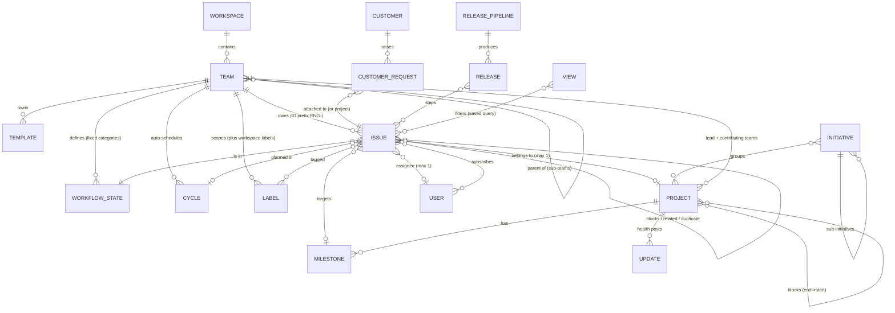

# Linear — Product Analysis for Daiq

> Research date: 2026-10-22 · Author: research agent for Daiq · Status: v1
> Scope: what Linear does, why it feels fast, where it breaks for non-software teams, and what Daiq should copy, trim or skip.
> Source tags like **[D3]** point to §1.3. Every URL was accessed 2026-10-22.

---

## 1. Method & sources

### 1.1 Method
- I read about 60 pages of Linear's first-party docs (`linear.app/docs/*`), developer docs (`linear.app/developers/*`), the Linear Method, selected changelog entries and engineering/design blog posts. I pulled each page as HTML, converted it to text and read it directly.
- For architecture I relied on Linear's own engineering posts and incident post-mortems, a podcast transcript with the CTO, and a reverse-engineering study the CTO has publicly called correct. That study is used for corroboration only (see the ⚠ note in §6).
- User sentiment comes from Hacker News comments, pulled through the Algolia HN API so each one has a permalink, plus third-party reviews and comparisons. Vendor-written comparisons are flagged as biased. G2 returned 403, so G2 claims below are second-hand.
- Limits: I did not use the app hands-on. The full keyboard map lives only in the in-app `?` sheet, so shortcuts not found in the docs are marked *(3rd-party)*. Plan gating is as of 2026-10.

### 1.2 Linear at a glance (2026-10)
- Positioning: "The system for product development", built for planning and shipping products alongside AI agents [W1]. It claims 40,000+ companies [W2].
- Plans: Free ($0: 2 teams, 250 issues), Basic ($10/user/mo: 5 teams), Business ($16: unlimited teams, private teams and guests, Insights, Asks, Triage Intelligence), Enterprise (SAML/SCIM, dashboards, advanced Asks) [W2].
- 2026 direction: most new surface area is AI and code: Linear Agent, Loops, coding sessions (Claude Code/Codex), Diffs (PR review), Releases, Code Intelligence [D30–D34, C1].

### 1.3 Source register (all accessed 2026-10-22)

| ID | Source | URL |
|---|---|---|
| W1 | Linear homepage (title/meta) | https://linear.app/ |
| W2 | Pricing | https://linear.app/pricing |
| M1 | Linear Method — Principles & Practices | https://linear.app/method/introduction |
| M2 | Method — Write issues not user stories | https://linear.app/method/write-issues-not-user-stories |
| M3 | Method — Scope projects down | https://linear.app/method/scope-projects |
| M4 | Method — Generate momentum | https://linear.app/method/building-with-momentum |
| D1 | Conceptual model | https://linear.app/docs/conceptual-model |
| D2 | Issues (creating, IDs, URLs, drafts, move team) | https://linear.app/docs/creating-issues |
| D3 | Issue properties (status, priority, labels, relations, estimates, SLAs, due dates) | https://linear.app/docs/issue-property |
| D4 | Parent and sub-issues | https://linear.app/docs/parent-and-sub-issues |
| D5 | Assign and delegate issues | https://linear.app/docs/assigning-issues |
| D6 | Cycles | https://linear.app/docs/use-cycles |
| D7 | Triage | https://linear.app/docs/triage |
| D8 | Teams | https://linear.app/docs/teams |
| D9 | Members & roles | https://linear.app/docs/members-roles |
| D10 | Private teams | https://linear.app/docs/private-teams |
| D11 | Sub-teams | https://linear.app/docs/sub-teams |
| D12 | Custom views | https://linear.app/docs/custom-views |
| D13 | Display options | https://linear.app/docs/display-options |
| D14 | Filters | https://linear.app/docs/filters |
| D15 | Board layout | https://linear.app/docs/board-layout |
| D16 | Timeline | https://linear.app/docs/timeline |
| D17 | Select issues | https://linear.app/docs/select-issues |
| D18 | Search | https://linear.app/docs/search |
| D19 | Projects | https://linear.app/docs/projects |
| D20 | Project milestones | https://linear.app/docs/project-milestones |
| D21 | Project status | https://linear.app/docs/project-status |
| D22 | Project dependencies | https://linear.app/docs/project-dependencies |
| D23 | Initiatives | https://linear.app/docs/initiatives |
| D24 | Initiative & project updates | https://linear.app/docs/initiative-and-project-updates |
| D25 | Inbox | https://linear.app/docs/inbox |
| D26 | Notifications | https://linear.app/docs/notifications |
| D27 | My issues | https://linear.app/docs/my-issues |
| D28 | Issue templates | https://linear.app/docs/issue-templates |
| D29 | Releases | https://linear.app/docs/releases |
| D30 | Loops | https://linear.app/docs/loops |
| D31 | Linear Agent | https://linear.app/docs/linear-agent |
| D32 | Coding sessions | https://linear.app/docs/coding-sessions |
| D33 | Reviews / Diffs | https://linear.app/docs/diffs |
| D34 | Usage & limits (AI spend) | https://linear.app/docs/usage-and-limits |
| D35 | GitHub integration | https://linear.app/docs/github |
| D36 | Customer requests | https://linear.app/docs/customer-requests |
| D37 | Linear Asks | https://linear.app/docs/linear-asks |
| D38 | Insights | https://linear.app/docs/insights |
| D39 | Dashboards | https://linear.app/docs/dashboards |
| D40 | API & webhooks (overview) | https://linear.app/docs/api-and-webhooks |
| D41 | Team issue limit | https://linear.app/docs/team-issue-limit |
| D42 | Delete & archive issues | https://linear.app/docs/delete-archive-issues |
| D43 | Team pages (Active/Backlog/Archive) | https://linear.app/docs/default-team-pages |
| D44 | Linear for Ops & Marketing | https://linear.app/docs/ops-and-marketing |
| D45 | Joining your team (shortcut guidance) | https://linear.app/docs/joining-your-team-on-linear |
| D46 | Pulse | https://linear.app/docs/pulse |
| D47 | Documents | https://linear.app/docs/documents |
| A1 | GraphQL getting started | https://linear.app/developers/graphql |
| A2 | API filtering | https://linear.app/developers/filtering |
| A3 | Pagination | https://linear.app/developers/pagination |
| A4 | Rate limiting | https://linear.app/developers/rate-limiting |
| A5 | Webhooks | https://linear.app/developers/webhooks |
| B1 | Rebuilding Linear's delta sync read path (2026-08-18) | https://linear.app/blog/rebuilding-delta-sync-read-path |
| B2 | Scaling the Linear Sync Engine (talk, 2023-06-29) | https://linear.app/blog/scaling-the-linear-sync-engine |
| B3 | Incident post-mortem, Jan 24 2024 (data loss / sync) | https://linear.app/blog/linear-incident-on-jan-24th-2024 |
| B4 | Security incident post-mortem, Mar 24 2026 (sync groups) | https://linear.app/blog/linear-incident-on-mar-24th-2026 |
| B5 | How we built multi-region support | https://linear.app/blog/how-we-built-multi-region-support-for-linear |
| B6 | How we redesigned the Linear UI (part II) | https://linear.app/blog/how-we-redesigned-the-linear-ui |
| B7 | A calmer interface (2026 refresh) | https://linear.app/blog/behind-the-latest-design-refresh |
| B8 | Invisible details — contextual menus | https://linear.app/blog/invisible-details |
| B9 | Settings are not a design failure | https://linear.app/blog/settings-are-not-a-design-failure |
| C1 | Changelog: Priority inbox (2026-09-03) | https://linear.app/changelog/2026-09-03-priority-inbox |
| C2 | Changelog: Time in status (2026-01-29) | https://linear.app/changelog/2026-01-29-time-in-status |
| C3 | Changelog: UI refresh (2026-03-12) | https://linear.app/changelog/2026-03-12-ui-refresh |
| C4 | Changelog: Keyboard shortcuts help (2021-03-25) | https://linear.app/changelog/2021-03-25-keyboard-shortcuts-help |
| P1 | localfirst.fm #15, Tuomas Artman (transcript) | https://www.localfirst.fm/15/transcript |
| R1 | wzhudev — Reverse engineering Linear's sync engine | https://github.com/wzhudev/reverse-linear-sync-engine |
| R2 | HN thread on R1 (CTO comments) | https://news.ycombinator.com/item?id=44123131 |
| H1–H12 | Hacker News user comments (permalinks inline in §7–§8) | https://news.ycombinator.com/ |
| T1 | Everhour — Linear vs Asana (vendor, biased) | https://everhour.com/blog/linear-vs-asana/ |
| T2 | Cotera — Linear vs Asana (vendor, anecdotal) | https://cotera.co/articles/linear-vs-asana-comparison |
| T3 | The New Stack — "Anti-agile" Linear vs Jira | https://thenewstack.io/anti-agile-project-tracker-linear-the-latest-to-take-on-jira/ |

---

## 2. Product & information architecture

### 2.1 Core model
- A **Workspace** holds **Teams**. The team is the primary unit: it owns its issues, workflow, triage, cycles, labels and templates [D1]. Since 2026, sub-teams nest up to 5 levels on Enterprise. They inherit cycles (forced), plus statuses, estimates and labels if they opt in [D11].
- Every **Issue** belongs to exactly one team, has an ID that is sequential within that team (`ENG-123`), and must have a title and a status [D2]. An issue has at most one project and one assignee [D19, D5].
- **Projects** carry an outcome and timeframe. They can span teams, but one of those teams is the lead team, which decides which project statuses apply [D19, D21]. Projects contain **Milestones** and **Updates**.
- **Initiatives** group projects around company goals and can nest as sub-initiatives [D23].
- **Views** are saved lenses (filters plus display options) over issues, projects or initiatives [D12].

### 2.2 Navigation IA (sidebar)
- **Personal:** Inbox (`G I`), My issues (`G M`: Assigned / Created / Subscribed / Activity tabs), Reviews (`G R`), Pulse, Drafts, Favorites [D25, D27, D33, D46].
- **Workspace:** Initiatives, Projects, Views, Customers (`G Q`), Dashboards [D23, D19, D12, D36, D39].
- **Per team:** Team home (docs and pins), Triage* (`G T`), Issues (All / Active / Backlog `G B`), Cycles*, Projects, Views, Archive (`G X`). Items marked * are opt-in per team [D8, D43].
- Teams you visit but haven't joined show up temporarily under "Exploring" [D8].
- The UI chrome is an "inverted L" (sidebar plus top bar) around one content pane, with optional right sidebars for details, insights and cycle graphs [B6].

### 2.3 Design language & Linear Method
- **Principles [M1]:** build for the people doing the work; purpose-built beats endlessly flexible; keep momentum rather than sprinting; avoid inventing new terms ("projects should be called projects"); say no to busywork; simple first, powerful later; decide and move on.
- **Practices [M1–M4]:** n-week cycles with automatic rollover; a small backlog (important requests resurface on their own); one owner per project and per issue; short specs; plain-language issues instead of user stories; scope projects to 1–3 people over 1–3 weeks; publish a changelog.
- **Visual system [B6, B7, C3]:** dense but calm. Themes are generated in LCH from three inputs (base, accent, contrast) instead of ~98 hand-set variables, which also yields high-contrast themes for free. Navigation is deliberately dimmer than content. Borders and icons are kept to a minimum ("structure should be felt, not seen"). The same layout runs in Electron and the browser.
- **Craft details [B8]:** sub-menus use a "safe triangle" so a diagonal mouse path doesn't close them. Context menus show each action's shortcut, so mouse users pick up the keyboard over time.
- **Settings stance [B9]:** separate *product settings* (Linear must get these right by default) from *preferences* (taste, deliberately left to the user). The settings page doubles as onboarding.

---

## 3. Issue model

### 3.1 Fields
| Field | Model | Notes |
|---|---|---|
| Identifier | `TEAMKEY-N`, sequential per team | Moving an issue to another team gives it a new ID; old IDs and URLs keep redirecting [D2] |
| Title / description | required / optional Markdown | Description has version history and restore [D2]. Edits in the first 3 minutes count as part of creation and stay out of the activity log [D2] |
| Status | one team workflow state | Required [D2] |
| Assignee | 0..1 user, plus optional delegated agent | Single owner by design [D5] |
| Priority | No priority · Urgent · High · Medium · Low | Not customizable on purpose [D3]. API: `0`=none, `1`=urgent … `4`=low [A2] |
| Estimate | team-chosen scale (optional) | Exponential 1–16 (+32, 64), Fibonacci 1–8 (+13, 21), Linear 1–5 (+6, 7), T-shirt XS–XL (+XXL, XXXL, mapped to Fibonacci). Optional explicit zero. Unestimated issues count as 1 by default [D3] |
| Labels | many; workspace or team scope | One level of label groups, single-select by default or multi-select, max 250 labels per group. Typing `Group/Label` creates both. Some names are reserved (priority, status, estimate…) [D3] |
| Project / milestone | 0..1 each | A milestone can only be set once the issue is in a project [D19, D20] |
| Cycle | 0..1 | Team cycles only [D6] |
| Parent | 0..1 | Multi-level sub-issue trees [D4, D35] |
| Due date **or** SLA | mutually exclusive | Applying an SLA replaces the due date [D3] |
| Subscribers | many | Auto-subscribed on create, assign or @mention [D26] |
| Attachments / links / PRs | many | Git and support-tool attachments [D35] |
| Customer requests | many | Can be marked important [D36] |
| Release | via pipeline | Business+ [D29] |
| Template of origin | 1 | Filterable, e.g. for intake reporting [D28] |
| Time in status | derived | 2026. Order or filter by it, e.g. "In Review > 7 days" [C2] |

There are **no general-purpose custom fields** on issues. Linear's stated workarounds are labels, label groups, extra statuses and form-template fields (which write into the description) [D3, D28]. Nothing in the changelog suggests custom fields are coming.

### 3.2 Relations
- **Blocked by** (`M` then `B`), **Blocks** (`M` then `X`), **Related** (`M` then `R`). Mentioning another issue in text creates a Related link automatically [D3].
- When the blocker resolves, the link drops back to Related [D3].
- **Duplicate:** done only from the duplicate's side. The issue moves to a reserved, system-managed *Duplicate* status, and in Triage its attachments and customer requests are merged into the canonical issue [D3, D7].
- **Parent/sub-issue:** a sub-issue inherits team, priority and project, and the cycle if created in an active status. Labels are *not* inherited. Optional automations: close the parent when all children close, close the children when the parent closes. A parent can be converted into a project [D4].

### 3.3 Workflow state categories
Categories are fixed and always in this order. Teams can rename, add and reorder statuses *within* a category, but each category must keep at least one status [D3].

| Category | Default statuses | Behaviour |
|---|---|---|
| *Triage* (opt-in) | Triage | Team inbox for issues from integrations or non-members. Hidden from views unless explicitly included [D7] |
| Backlog | Backlog (plus e.g. Icebox) | First backlog status is the default for new issues. Moving an issue into a cycle promotes it to Todo [D43] |
| Unstarted | Todo | "Active" = Unstarted + Started [D43] |
| Started | In Progress (plus e.g. In Review, Ready to Merge) | Drives cycle and milestone progress [D20] |
| Completed | Done | Feeds auto-archive [D42] |
| Canceled | Canceled (plus Won't fix…) | Decline in triage lands here [D7] |
| *Duplicate* | Duplicate (system) | Cannot be renamed [D3] |

Hygiene automations: **auto-close** stale issues and **auto-archive** closed ones. Archiving cannot be done by hand [D3, D42].

---

## 4. Feature inventory by domain

**Planning hierarchy**
- Projects: lead, members, status (customizable; per team on Business+), priority, labels, start/target dates at fuzzy granularity (year, half, quarter, month, day), documents, links, issue views attached as tabs, `P-TEAM-N` IDs [D19, D21].
- Milestones: per project, ordered, optional date, % progress (counts from *started*), the next open milestone highlighted. Cannot be shared across projects [D20].
- Project updates: health (On track / At risk / Off track) plus rich text. Scheduled reminders to the lead with follow-up nudges; "update missing" staleness flag; posts to Slack with synced comments; agent-drafted updates (2026) [D24].
- Initiatives: status (Proposed → Planned → Active → Completed / Canceled), owner, priority, labels, target date, roll-up of project health, sub-initiatives, team-led initiatives [D23].
- Project dependencies: end→start only. Shown on the timeline; dragging bumps the chain; violated dependencies turn red [D22].
- Timeline: **projects only**. Zoom week/month/quarter/year, cycle overlay, milestones and dependencies drawn in [D16].

**Execution**
- Cycles: 1–8 weeks, fixed start weekday, optional cooldown, up to 15 future cycles created automatically, unfinished issues roll over, optional auto-add of started/completed issues, capacity dial based on the last 3 cycles' velocity, iCal feed [D6].
- Triage: accept `1`, decline `2`, duplicate `3`, snooze `H`. Rules engine and Triage Intelligence (AI suggestions) on Business+. On-call rotation via PagerDuty/OpsGenie/incident.io. Can require a priority before an issue leaves triage [D7].
- SLAs (Business+): rules evaluated in order and matched on any filterable field. Defaults are Urgent=24h and High=1 week, with a removal rule for lower priorities. Business-day support; risk bands from low to breached [D3].
- Recurring issues, email-to-issue (per team or per template), `linear.new` URLs with prefill parameters [D2].
- Templates: standard and form templates, workspace or team scope, can include sub-issues, and can be a default per audience (members vs non-members) [D28].

**Views & reporting**
- Views over issues, projects or initiatives. Personal or shared, team or workspace scope, favorites, owner, Slack or personal subscriptions to "issue entered / closed" [D12].
- Display options: list ↔ board (`Cmd B`), grouping and sub-grouping (swimlanes), ordering (manual order is global to the workspace), shown properties, empty groups, sub-issue nesting. Choices are personal unless someone hits "Set as default" for the workspace [D13, D15].
- Filters: `F`, typed quick-filters, is/is not/any/all/none/before/after operators, nested AND/OR (2026), natural-language "filter with AI", filters encoded in the URL [D14].
- Insights (Business+): measures (count, effort, cycle/lead/triage time, age, time in status) × slice × segment, built on any view. Dashboards are Enterprise-only [D38, D39, C2].

**Communication**
- Inbox: subscription-driven, `J`/`K` to move, snooze, reminders, a 2,000-notification cap, Priority tab (2026). Channels: desktop, mobile, Slack, email digests (sent only if the notification is still unread). No browser push [D25, D26, C1].
- Pulse feed of updates; documents on projects, initiatives, teams, issues and cycles; inline comments [D46, D47].

**Intake & customers**
- Asks (Business+): Slack, email and web forms (web forms on Enterprise only) → issue in Triage with a synced thread [D37].
- Customer requests: customers with revenue, tier and size (synced from Intercom and others), requests attached to issues or projects, "important" flag, customer pages, filtering by customer attributes [D36].

**Engineering**
- GitHub/GitLab: copy branch name (`Cmd Shift .`); link via branch, PR title or magic words. *Closing* words (fixes, closes, resolves…), *non-closing* words (refs, part of…) and `skip ENG-123`. PR state drives status, with per-branch rules (regex). `ENG-NEW` in a PR creates an issue. Two-way GitHub Issues sync [D35].
- Releases (Business+): CI pipelines (continuous or scheduled), path filters for monorepos, auto release notes and changelog [D29].
- AI and code (2026): Linear Agent, Loops (scheduled or event-driven agent automations), coding sessions, Diffs code review, usage-based AI credits with spend limits [D30–D34].

**Admin & platform**
- Roles: Owner (Enterprise), Admin, Team owner (Business+), Member, Guest (Business+, billed as a member). Private teams (Business+) and issue sharing out of private teams (Enterprise) [D9, D10].
- Public GraphQL API, the same one the app uses. Relay cursors with 50 items by default; filter DSL with `and`/`or`, `some`/`every`, `null` and relative ISO-8601 dates (`P2W`). Rate limits are leaky-bucket: 2,500 req/h on API keys, 5,000 on OAuth, plus complexity points and a 10,000-point per-query cap. Webhooks for ~14 models carry the previous values of changed fields, are HMAC-signed and retried up to 3× [A1–A5, D40].
- Hard limit: **60,000 non-archived issues per team**, justified on performance grounds [D41].

---

## 5. Keyboard & speed-oriented interaction patterns

### 5.1 How the system works
1. **One verb, any target.** Each shortcut acts on whatever is *in focus*: the open issue, the hovered row, the `J`/`K` cursor, or a multi-selection. `P` sets priority on one issue or on 300 selected after `Cmd A` [D3, D17]. Hovering focuses a row, so the mouse and keyboard work together ("press A when viewing or hovering") [D5].
2. **Three layers that teach each other.** Single keys handle frequent edits. Chords (`G`/`O`/`N`/`M` then a letter) handle navigation and less common verbs. `Cmd K` is a contextual command menu that lists everything. Right-click menus show the same commands with their shortcut hints, and `?` opens a searchable shortcut sheet [B8, C4, D45].
3. **Property pickers are type-to-filter popovers.** Press a key, type a few letters, hit Enter, and the popover closes with no confirmation step. The same picker is reused in every context (sidebar, board card, bulk bar).
4. **Two kinds of search.** `/` is global full-text search. `O I` jumps to an issue by ID or title. Typing an ID plus Enter opens it. Inside the command menu, prefixes scope results: `i ` issues, `p ` projects, `u ` users, `t ` teams, `l ` labels, `d ` docs, `f ` favorites [D18].
5. **Peek before you open.** `Space` toggles a preview of the focused issue or project; holding Space peeks only while held [D12]. Linear's docs call it their favourite shortcut [D45].
6. **Everything has a URL.** `linear.new?title=…&assignee=me&priority=Urgent` creates an issue in one step. `/issues/ENG-1,ENG-2` opens an ad-hoc list. Filters live in the URL [D2, D12, D14].
7. **Forgiving speed.** `Cmd Z` undoes deletes and team moves [D2, D42]. Unsent issues survive as local drafts, and `Esc` offers to save a synced draft [D2]. Sub-issue creation chains: after save it opens the next one, and `Cmd Shift Enter` keeps the same properties [D4].

### 5.2 Shortcut map (docs-confirmed unless marked)

| Area | Keys → action |
|---|---|
| Global | `C` new issue · `Alt C` new from template · `Cmd K` command menu · `/` search · `?` shortcut help · `Cmd Z` undo · `N I` new initiative |
| Go-to (`G` then…) | `I` inbox · `M` my issues · `T` triage · `B` backlog · `X` archive · `Q` customers · `R` reviews · `S` settings · *(3rd-party: `A` active, `P` projects, `C` cycles)* |
| Open (`O` then…) | `I` issue by ID/title · `T` team · `U` user · `L` label · `V` view · `F` favorites · `D` document · `Q` customer · `W` workspace · `R` review |
| List / board nav | `J`/`K` or `↑`/`↓` move · `Enter` open · `Space` peek · `X` select · `Shift X` / `Shift ↑↓` range · `Cmd A` select all · `Esc` clear · `T` collapse group · `Alt ↑↓` nudge, `Alt Shift ↑↓` top/bottom (manual order) |
| Edit properties | `S` status · `A` assignee · `I` assign to me · `P` priority · `L` labels · `Shift E` estimate · `Shift D` due date · `Shift P` project · `Shift M` milestone · `Cmd Shift P` set parent · `Cmd Shift M` move team · `Cmd Shift O` sub-issue (also converts selected text or a checklist) · `Cmd Delete` delete |
| Relations | `M B` blocked by · `M X` blocks · `M R` related · `M M` duplicate |
| Subscriptions | `Shift S` subscribe/unsubscribe · `Cmd Shift S` manage subscribers · `H` remind me / snooze |
| Views | `F` filter · `Shift V` display options · `Cmd B` list↔board · `Alt V` save as view · `Cmd F` find in view · `Alt F` favorite · `Cmd Shift I` insights · `Cmd I` details sidebar |
| Inbox | `U` read/unread · `Alt U` mark all read · `Backspace` delete · `Shift Backspace` delete all read · `H` snooze |
| Triage | `1` accept · `2` decline · `3` duplicate · `H` snooze |
| Git | `Cmd Shift .` copy branch name (can also auto-assign and move the issue to Started) · `W O` work on issue in a coding tool |
| Editor | `Cmd Enter` post comment · `Cmd Alt M` inline comment · `Cmd Shift A` attach · `/` slash menu |

### 5.3 Speed patterns beyond keys
- **Optimistic, local-first edits:** nothing waits on the network (§6). Linear has called the sync engine's payoff for engineers as big as the speed itself [P1].
- **Workspace-global manual order:** dragging under priority or manual ordering changes the order everyone sees, so there's one shared ranking [D3, D13].
- **Drag between groups writes the property:** dropping a card into the "High" column sets priority to High [D13].
- **Smart defaults remove decisions:** default status, default template per audience, assign-on-create, auto-assign and start on branch copy, cycle rollover, auto-archive [D3, D5, D6, D28, D35].
- **Low-noise activity:** early edits are folded into creation [D2]. You don't get notified about your own actions in subscribed views [D12]. Email goes out only if the in-app notification is still unread [D26].
- **Desktop-native feel:** Electron app with tabs and back/forward that collapse cleanly in the browser. Notifications prefer the active desktop session [B6, D26].

---

## 6. Architecture insights relevant to perceived speed

### 6.1 What Linear says publicly (first-party)
- **Local-first client.** Each client keeps a local database, so creating an issue, changing status or navigating needs no network round trip [B1]. The UI renders from in-memory objects, and local changes propagate to the server and other users through the sync layer [P1].
- **An application-level change log is the backbone.** Every relevant change becomes a *sync action* with an ordered ID, the affected model, the change type, routing metadata and a payload. Each workspace has an immutable, append-only log that clients replay into their local DB. It sits a level above the Postgres WAL and speaks the client's vocabulary (update issue, archive project…) [B1]. Sync packets carry the action type, a full entity snapshot and the changed properties [B3].
- **Delta sync from a checkpoint.** A reconnecting client sends the ID of the last action it applied and receives only what came after. Large workspaces produce about 1M actions a day, and >20 TB of actions are stored [B1].
- **Permissions live in the sync layer.** "Sync groups" encode access, and "sync subscriptions" narrow it to the models and views a client needs. Every query (web, mobile, API) passes through sync-group resolvers [B1, B4].
- **Serving path (2026).** The catch-up query is an ID range intersected with permission and subscription sets. Linear moved it from Postgres to an inverted index (turbopuffer posting lists, one namespace per workspace) fed by CDC (about 1 s at p50). Postgres still serves the authoritative head of the log, the two ranges overlap and are deduplicated, and Postgres is the fallback. The new path ran in shadow mode before cutover. Payloads are fetched only after filtering ("late enrichment") [B1].
- **Realtime transport is WebSockets**, routed per region through Cloudflare Workers. Engineers "should never have to think about multi-region", and the sync-engine update logic was reused to keep services in sync [B5].
- **Scale ceiling is real.** Teams are capped at 60k non-archived issues for performance [D41]. Auto-archive is one of the main levers. `linear.app/reset` wipes the local database when it gets out of sync [D35].
- **Talks:** React Helsinki (2020) and "Scaling the Linear Sync Engine" (2023) [B2]. CTO quote: with sync you are "effectively just building the front end"; sync suits bounded datasets, not search-engine-scale data [P1].

### 6.2 Lessons from Linear's own incidents
- **Jan 2024 [B3]:** a migration cascade-deleted rows *directly in SQL*. That created no sync packets, so clients kept serving stale cached data and the loss went unnoticed for about 30 minutes. A cursor cached in Redis assumed IDs never move backwards, which broke after a restore. Forcing all clients to refresh overloaded the API. Takeaways: **every write must go through the log**; cursors must survive restores; full re-bootstraps need rate control; a read-only mode is worth having.
- **Mar 2026 [B4]:** a variable-shadowing bug dropped the per-user sync-group filters, and queries **failed open**. About 7,000 full bootstraps pulled private-team data into local client DBs, plus emails and API responses. The fix needed a server cache reset, a bump of the "database version" to force every client to purge its cache, and logging out mobile clients. Takeaways: **permission filtering must fail closed**; a global client-cache kill switch is mandatory; test the *disabled* branch of every flag.

### 6.3 Corroborating detail (reverse-engineering study, R1)
> ⚠ R1 is unofficial. Linear's CTO called it correct [R2], but its own disclaimer asks readers not to use the findings to build competing software. **Daiq should not use R1's annotated code or naming.** It is cited here only to confirm the general patterns that Linear's own talks and posts already describe, and that open-source local-first engines (e.g. Replicache/Zero, ElectricSQL, PowerSync) document independently.
- Observable in-memory object graph (MobX). Models are declared with metadata and load strategies (instant, lazy, partial, on-demand).
- One IndexedDB database per workspace. Full, partial or local bootstrap; lazy hydration of rarely needed models.
- A client edit updates the in-memory model at once and queues a *transaction*. Transactions are batched, persisted in IndexedDB while offline and replayed on reconnect. The local DB is written only when the server's delta arrives.
- The server executes the change, adds side effects (e.g. history) and broadcasts deltas to *all* clients, including the sender. Conflicts are **last-writer-wins** on update transactions. Undo/redo works by emitting inverse transactions.

### 6.4 Implications for Daiq (self-hosted, open source)
1. Build the client on an **in-memory reactive store with persistent local storage** and an **optimistic mutation queue**. The UI never awaits the server.
2. The server is authoritative: **validate, apply, then append to a per-workspace monotonically ordered change log**. Push deltas over WebSocket and catch up from a checkpoint on reconnect. Field-level LWW is enough for structured fields. Use a text CRDT only if rich-text co-editing becomes a requirement.
3. Make **permission scoping part of the log entries** (team/visibility keys) and **fail closed**. Ship a **schema/cache epoch** that forces every client to rebootstrap.
4. For a self-hosted v1, **Postgres is enough** (an indexed `changes` table keyed by workspace and id). Linear only needed an inverted index at about 1M actions/day per workspace. Revisit if any deployment approaches that.
5. Plan **partial sync from day one**: active plus recent issues are synced, archived items load on demand. This avoids Linear-style hard caps.
6. Evaluate an off-the-shelf sync engine against a small in-house log before building, and record the decision in an ADR. The team size and self-hosting simplicity both matter here.

---

## 7. What users love (evidence)

| Theme | Evidence |
|---|---|
| **Speed** | Compared with Asana, "blazing fast" with shortcuts for everything (H1, 2020: https://news.ycombinator.com/item?id=25554626). "Don't underestimate the speed feature"; teams stop using Jira (H2, 2023: https://news.ycombinator.com/item?id=35059747). A user on poor Wi-Fi measured DOMContentLoaded at 360 ms and interactive at about 600 ms, with near-instant loads from cache (H3, 2025: https://news.ycombinator.com/item?id=43545218). |
| **Keyboard-first** | Linear: shortcuts are "frequently used and loved by our power users" [C4]. Users praise "outstanding keyboard shortcuts" (H4, 2022: https://news.ycombinator.com/item?id=30995246) and "fast performance and keyboard shortcuts" after Jira (H5, 2022: https://news.ycombinator.com/item?id=30974181). |
| **Adoption & participation** | After switching from Jira, "participation on issues went through the roof", with simpler, non-agile terms (H6, 2022: https://news.ycombinator.com/item?id=31932329). |
| **Opinionated defaults** | Works with no setup (H4). The opinions "keep project managers in check" versus Jira's KPI sprawl (H7, 2024: https://news.ycombinator.com/item?id=39376248). Opinions are "mostly sensible" (H8, 2023: https://news.ycombinator.com/item?id=38301878). |
| **Cadence tools** | Cycles plus projects keep a two-week release rhythm, and realtime sync is valued (H9, Raycast co-founder, 2022: https://news.ycombinator.com/item?id=33201425). |
| **Triage** | Credited with solving inbound triage, which "most other issue trackers do not deal with well" (H8). |
| **Polish** | "Most polished, productive interface" among Pivotal, Jira, Trello, Asana and GitHub (H10, 2020: https://news.ycombinator.com/item?id=23694629). Third-party reviews keep repeating speed and design (T3). |

---

## 8. Where Linear is limiting for non-software teams (evidence)

**Structural limits (first-party)**
- **No custom fields.** Priority levels are fixed by policy, and the docs suggest statuses or labels as the workaround [D3]. Ops and marketing teams are pointed to Zapier for forms and recurring work [D44]. Third-party comparisons call missing custom fields the top blocker for non-developer teams (T1, vendor-biased).
- **Software-shaped vocabulary and defaults:** cycles, estimates, triage, PR automations, releases and, since 2026, coding agents and code review. The homepage now says "product development … with AI agents" [W1, D29–D33].
- **Timeline shows projects only.** Dated issues can't go on a timeline or calendar [D16]. Content and event teams live in dated tasks.
- **Rigid cardinalities:** one team per issue, one project per issue (workaround: split into sub-issues), one assignee, one project lead, milestones not shareable across projects, and no way to view several teams' cycles at once [D2, D5, D8, D19, D20].
- **No manual archive**, only time-based auto-archive [D42]. Triage issues are hidden from views by default [D7].
- **Tier gating of basics:** private teams, guests, Insights, Asks and SLAs need Business. Dashboards and Asks web forms need Enterprise. Free stops at 250 issues [W2, D37, D39].
- **Hard 60k-issue-per-team cap** [D41], an architectural cost that high-volume ops teams (support, IT) hit first.

**User-reported friction**
- "Explicitly not a general purpose replacement for Jira" (H8). It is "better for software development … worse at other things" (H11, 2022: https://news.ycombinator.com/item?id=32376427).
- Almost no automations, GraphQL-only API, and a product that "seems to exist mainly to get you to follow their pet process" (H12, 2023: https://news.ycombinator.com/item?id=36151018). Automations have improved since, but most of them are now AI and Loops that bill against credits [D30, D34].
- **View-state confusion:** a manager of two product teams (13 people) says filters persist per user on built-in views and display options act as hidden defaults, so the same link shows different data to different people. Too many sidebars; after months "not a single person feels comfortable" (https://news.ycombinator.com/item?id=40762405, 2024).
- Docs are tied to projects, which raises the question "which project does this doc belong to?" (same comment). This was partly fixed by team documents in 2026 [D47].
- Keyboard-centric UX raises the learning curve for non-technical users, and some companies run Linear for engineering next to Asana for marketing and ops (T1, T2: vendor or anecdotal sources).

---

## 9. Recommendations for Daiq

### 9.1 Reproduce (close to as-is)
1. **Team-keyed human IDs** (`OPS-42`): sequential per team, the URL *is* the ID, old IDs redirect after a move, and pasting an ID anywhere opens the item.
2. **Fixed status categories with custom statuses inside them** (Backlog · Unstarted · Started · Completed · Canceled, plus optional Triage). Every automation, report and roll-up runs on categories, never on status names.
3. **Five-level priority including "No priority"**, no customization. Urgent notifies the assignee. Keep a workspace-global manual rank.
4. **The keyboard grammar:** single-key verbs on the focused/hovered/selected item(s); `G`- and `O`-chords; contextual `Cmd K`; searchable `?` sheet; shortcut hints in every menu and tooltip; `J`/`K`, `X`, `Space` peek, `Esc`. Bulk edits behave exactly like single edits.
5. **Type-to-filter property pickers** shared across sidebar, list, board and bulk bar, with no confirm step.
6. **Local-first sync:** in-memory reactive store, persistent local cache, optimistic mutation queue that survives offline, server-ordered change log, WebSocket deltas, checkpoint catch-up, field-level LWW, inverse-op undo (§6.4).
7. **Fail-closed permission scoping inside the sync log**, plus a client-cache epoch kill switch (from B4).
8. **Triage as a team inbox** with accept, decline, duplicate and snooze on `1`/`2`/`3`/`H`. All intake (forms, email, API, non-members) lands there.
9. **Subscription-based Inbox:** auto-subscribe on create, assign or mention; snooze and reminders; no notifications for your own actions; email only if still unread.
10. **Views = filters + display options, encoded in the URL.** List ↔ board, group plus sub-group, dragging between groups sets the property.
11. **Creation shortcuts:** `/new?title=&assignee=me` prefill URLs, synced drafts, pasted list → sub-issues, "create more" chaining.
12. **Projects with one lead, milestones and health updates** (On track / At risk / Off track) with a gentle reminder cadence.
13. **Public API = the app's own API**, plus signed and retried webhooks that include previous values.
14. **Design discipline:** LCH theme generation from 3 inputs, dim navigation, few borders, safe-triangle submenus. Separate opinionated defaults from personal preferences [B6–B9].

### 9.2 Simplify (keep the power, cut the surface)
1. **Hierarchy:** Workspace → Team → Project → Issue (+ sub-issues). Skip initiatives, sub-initiatives and multi-level sub-teams in v1. A project tag or label covers "goal" grouping until real demand appears.
2. **Add the one thing Linear refuses: a *small* typed custom-field set** (text, number, date, single/multi-select, person), capped per team (e.g. ≤10) and filterable. This is the main gap for non-software teams, and capping it avoids ClickUp-style sprawl.
3. **Labels:** one level of groups with single/multi-select, as Linear does. Drop separate project and initiative label systems.
4. **One timeline/calendar for anything with dates.** Show projects *and* dated issues, with the issue layer optional. Use Linear's fuzzy target dates (month, quarter) for projects.
5. **Cycles as an optional team module** with auto-schedule and rollover only. Leave capacity dials, cooldown nuances and calendars for later.
6. **Estimates:** off by default; when on, one scale per team (points or T-shirt).
7. **Display options with explicit state:** a visible "modified from shared default" chip, one-click reset, and shared links that carry the full view state so everyone sees the same thing (fixes the friction reported in §8).
8. **Reporting:** ship 4–5 fixed charts (throughput, cycle time, time in status, burn-up, open by assignee) on any view instead of a measure × slice × segment builder.
9. **Intake:** one public form builder plus email-in per team, both landing in Triage. Linear gates these to Business/Enterprise; Daiq ships them in core.
10. **SLAs:** a single rule type (priority → deadline, business days optional) instead of a full rule engine.
11. **Templates:** one template type with optional form fields. Don't split into standard and form templates.
12. **Roles:** Admin / Member / Guest plus private teams. Skip team-owner granularity until it's requested.
13. **Notifications:** inbox, one optional daily digest and Slack/webhook. Avoid per-category channel matrices.

### 9.3 Avoid
1. **AI/agent scope creep in core.** Linear's 2026 surface (agents, loops, coding sessions, diffs, AI credits) is what pushes it away from non-software teams. Daiq core should expose clean API and webhook hooks; agents can be plugins.
2. **Plan-gating fundamentals.** As OSS and self-hosted, private teams, guests, intake forms, insights and SLAs should all be in core.
3. **Hidden per-user state on shared surfaces**, such as built-in views silently remembering one person's filters (§8).
4. **Information overload:** several stacked right sidebars, many icon treatments. Keep one optional details panel.
5. **Hard caps forced by full-client sync** (60k/team). Use partial sync and lazy loading of archived and historical data instead.
6. **Auto-only archiving.** Offer manual archive plus an optional auto policy.
7. **Writes that bypass the change log** (raw SQL migrations, admin scripts) and cursors that assume IDs only grow (from B3). Enforce both with a lint rule or test and a restore runbook.
8. **Software-only defaults for every team.** Make team templates (Software, Marketing, Ops/IT, Generic) choose statuses, enabled modules (cycles, estimates, Git) and vocabulary. Keep Linear's "don't invent terms" rule.
9. **A general-purpose CRDT for structured data.** Linear runs fine on LWW plus a server-ordered log; CRDTs add metadata and permission complexity.
10. **Reusing reverse-engineered internals (R1).** Derive the design from public talks and open-source sync engines only.
11. **Mouse-hostile power.** Linear's keyboard bias raises the learning curve for non-technical users (§8). Every keyboard verb needs a visible mouse path, and right-click menus should teach the shortcut.
